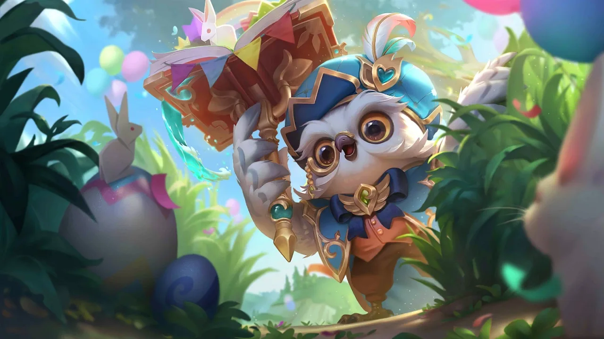
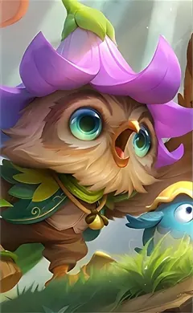

[Скины Дигги](https://boostmlbb.ru/skins/diggie.html)

[Скины](https://boostmlbb.ru/skins/)/[Дигги](https://boostmlbb.ru/skins/diggie.html)/Сказочник

[Скин Дигги](https://boostmlbb.ru/skins/diggie.html)

# Сказочник

Fairytaler

Делюкс DeluxeЭпическийОграниченный

Как получить

Выходил в магазине обликов во время события. Ограниченные облики иногда возвращаются в розыгрышах событий.

Вышел

9 апреля 2022

## Что меняет облик

-   Новая внешность
-   Новые эффекты навыков
-   Анимация показа
-   Сцена показа
-   Бонус к характеристикам

## Все скины Дигги [5](https://boostmlbb.ru/skins/diggie.html)

[Хранитель подлескаОбычный · 2024](https://boostmlbb.ru/skins/diggie/underwood-steward.html)[СказочникДелюкс · 2022](https://boostmlbb.ru/skins/diggie/fairytaler.html)[Цирковой клоунОбычный · 2021](https://boostmlbb.ru/skins/diggie/circus-clown.html)[СозвездиеИсключительный · 2019](https://boostmlbb.ru/skins/diggie/constellation.html)[ГолубятникОбычный · 2017](https://boostmlbb.ru/skins/diggie/pigeoneer.html)

## Серия «Эпический»

[Надзи­ратель преис­поднейМинотавр · 2026](https://boostmlbb.ru/skins/minotaur/nether-overseer.html)[Затонувшее проклятиеАтлас · 2026](https://boostmlbb.ru/skins/atlas/sunken-curse.html)[Вечная клятваВексана · 2026](https://boostmlbb.ru/skins/vexana/eternal-vow.html)[Проклятый свитокХуфра · 2025](https://boostmlbb.ru/skins/khufra/cursed-scroll.html)[Охотница за душамиНаталья · 2025](https://boostmlbb.ru/skins/natalia/soul-huntress.html)[Граф кошмаровЛеоморд · 2025](https://boostmlbb.ru/skins/leomord/nightmare-count.html)[Вершитель звёздБелерик · 2025](https://boostmlbb.ru/skins/belerick/arbiter-of-stars.html)[Хранитель ветровВэйл · 2025](https://boostmlbb.ru/skins/vale/keeper-of-the-winds.html)

**Сколько стоит буст на герое Дигги?**Выберите текущий и желаемый ранг. Стоимость появится на сайте.

[Рассчитать цену](https://boostmlbb.ru/order.html?type=hero)

## Частые вопросы

Как получить скин «Сказочник» на Дигги?

Выходил в магазине обликов во время события. Ограниченные облики иногда возвращаются в розыгрышах событий.

Когда вышел скин «Сказочник»?

9 апреля 2022.

Какой класс у скина «Сказочник»?

Делюкс (Deluxe), серия «Эпический».
