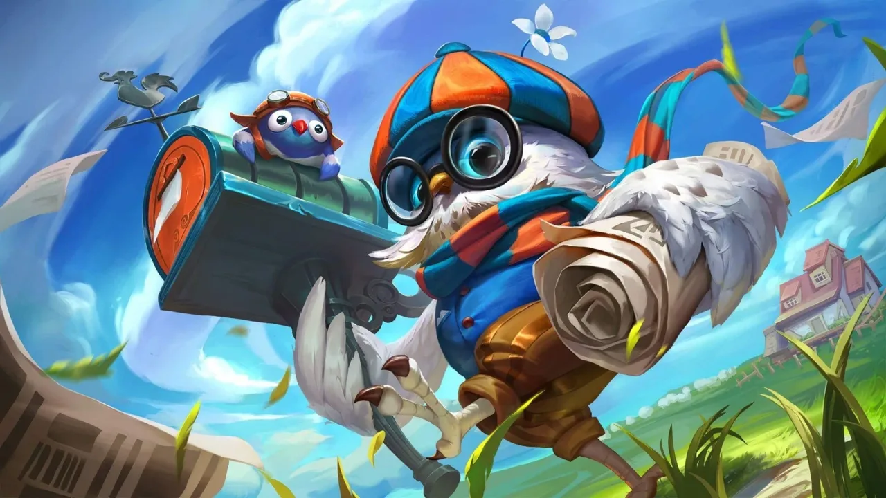

[Скины Дигги](https://boostmlbb.ru/skins/diggie.html)

[Скины](https://boostmlbb.ru/skins/)/[Дигги](https://boostmlbb.ru/skins/diggie.html)/Голубятник

[Скин Дигги](https://boostmlbb.ru/skins/diggie.html)

# Голубятник

Pigeoneer

Обычный CommonВ продаже

Как получить

Продаётся в магазине обликов за 269 алмазов.

Цена

269 алмазов

Вышел

27 октября 2017

## Что меняет облик

-   Бонус к характеристикам

## Все скины Дигги [5](https://boostmlbb.ru/skins/diggie.html)

[Хранитель подлескаОбычный · 2024](https://boostmlbb.ru/skins/diggie/underwood-steward.html)[СказочникДелюкс · 2022](https://boostmlbb.ru/skins/diggie/fairytaler.html)[Цирковой клоунОбычный · 2021](https://boostmlbb.ru/skins/diggie/circus-clown.html)[СозвездиеИсключительный · 2019](https://boostmlbb.ru/skins/diggie/constellation.html)[ГолубятникОбычный · 2017](https://boostmlbb.ru/skins/diggie/pigeoneer.html)

**Сколько стоит буст на герое Дигги?**Выберите текущий и желаемый ранг. Стоимость появится на сайте.

[Рассчитать цену](https://boostmlbb.ru/order.html?type=hero)

## Частые вопросы

Как получить скин «Голубятник» на Дигги?

Продаётся в магазине обликов за 269 алмазов.

Когда вышел скин «Голубятник»?

27 октября 2017.

Какой класс у скина «Голубятник»?

Обычный (Common).
