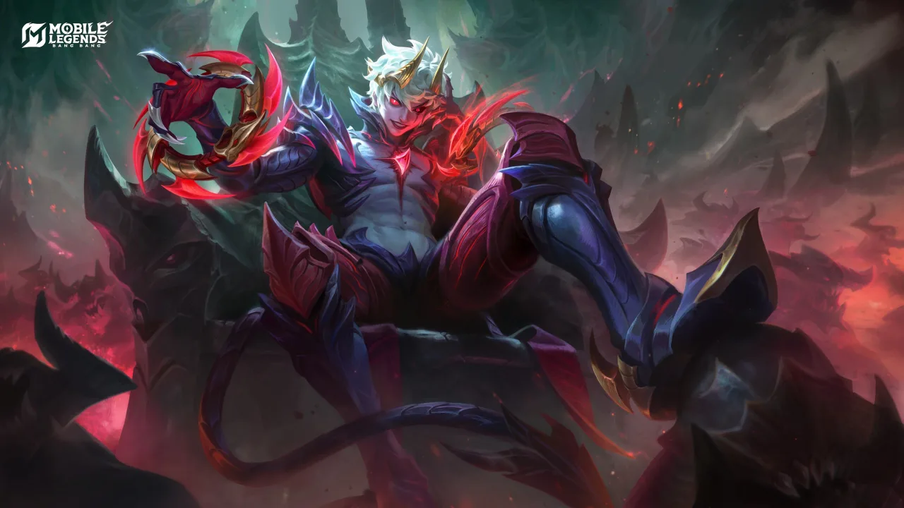

[Тир-лист](https://boostmlbb.ru/heroes/)[Предметы](https://boostmlbb.ru/items/)[Скины](https://boostmlbb.ru/skins/)[Новости и гайды](https://boostmlbb.ru/news/)

[Скины](https://boostmlbb.ru/skins/)/Дариус

# Скины Дариуса

Скинов

6

Можно купить

2

Последний

[Гон](https://boostmlbb.ru/skins/dyrroth/gon.html)2025

[Профиль героя→](https://boostmlbb.ru/heroes/dyrroth.html)

## Все скины

[ГонГрандиозный · 2025](https://boostmlbb.ru/skins/dyrroth/gon.html)[Пламя НаракиИзысканный · 2023](https://boostmlbb.ru/skins/dyrroth/naraka-flame.html)[Кобра V.E.N.O.M.Делюкс · 2022](https://boostmlbb.ru/skins/dyrroth/v-e-n-o-m-cobra.html)[Орочи КрисГрандиозный · 2020](https://boostmlbb.ru/skins/dyrroth/orochi-chris.html)[Мародёр руинИсключительный · 2019](https://boostmlbb.ru/skins/dyrroth/ruins-scavenger.html)[Чешуйчатый бурОбычный · 2019](https://boostmlbb.ru/skins/dyrroth/scalebore.html)

**Поднимем ранг на герое Дариус**Цена считается в калькуляторе

[Рассчитать цену](https://boostmlbb.ru/order.html?type=hero)

## Частые вопросы

Сколько скинов у Дариуса?

6 скинов без стандартного облика. Последний — «Гон» (Gon), 14 января 2025.

Какие скины Дариуса можно купить сейчас?

«Кобра V.E.N.O.M.» (899 алмазов), «Чешуйчатый бур» (269 алмазов). Остальные облики ограниченные и возвращаются только в событиях.

Какой самый редкий скин Дариуса?

«Гон» (Gon), класс грандиозный, серия «Охотник × Охотник». Выходил в событии коллаборации MLBB × Охотник × Охотник. Ограниченные облики иногда возвращаются в розыгрышах событий.
