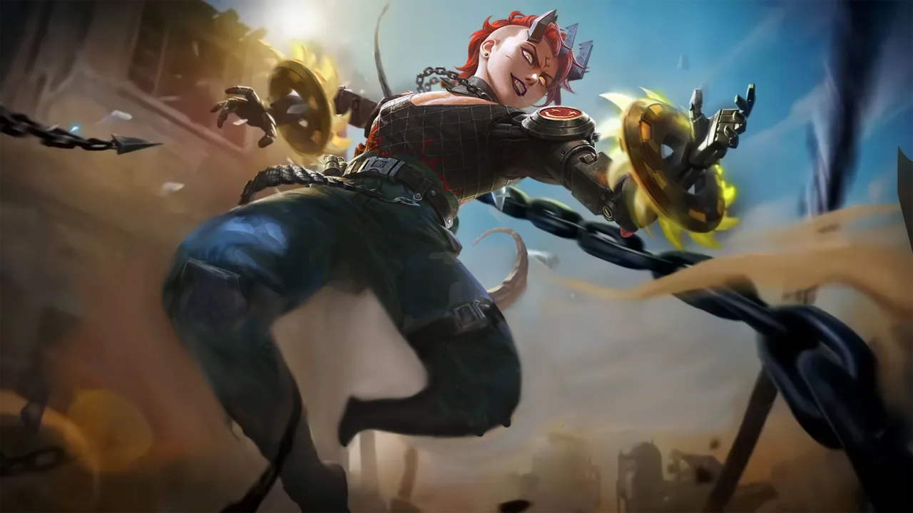

[Скины Дариуса](https://boostmlbb.ru/skins/dyrroth.html)

[Скины](https://boostmlbb.ru/skins/)/[Дариус](https://boostmlbb.ru/skins/dyrroth.html)/Мародёр руин

[Скин Дариуса](https://boostmlbb.ru/skins/dyrroth.html)

# Мародёр руин

Ruins Scavenger

Исключительный ExceptionalЗвёздный участникОграниченный

Как получить

Награда «Звёздного участника» в декабре 2019.

Вышел

1 декабря 2019

## Что меняет облик

-   Новая внешность
-   Новые эффекты навыков
-   Анимация показа
-   Бонус к характеристикам

## Все скины Дариуса [6](https://boostmlbb.ru/skins/dyrroth.html)

[ГонГрандиозный · 2025](https://boostmlbb.ru/skins/dyrroth/gon.html)[Пламя НаракиИзысканный · 2023](https://boostmlbb.ru/skins/dyrroth/naraka-flame.html)[Кобра V.E.N.O.M.Делюкс · 2022](https://boostmlbb.ru/skins/dyrroth/v-e-n-o-m-cobra.html)[Орочи КрисГрандиозный · 2020](https://boostmlbb.ru/skins/dyrroth/orochi-chris.html)[Мародёр руинИсключительный · 2019](https://boostmlbb.ru/skins/dyrroth/ruins-scavenger.html)[Чешуйчатый бурОбычный · 2019](https://boostmlbb.ru/skins/dyrroth/scalebore.html)

## Серия «Звёздный участник»

[Морячка, рождённая приливомКалеа · 2026](https://boostmlbb.ru/skins/kalea/tideborn-sailor.html)[Тень кицунэХаябуса · 2026](https://boostmlbb.ru/skins/hayabusa/kitsune-s-shadow.html)[Клыки резниХанзо · 2026](https://boostmlbb.ru/skins/hanzo/fangs-of-slaughter.html)[Тлеющая крепостьБелерик · 2026](https://boostmlbb.ru/skins/belerick/smouldering-fortress.html)[Магитех­нический призракОбсидия · 2026](https://boostmlbb.ru/skins/obsidia/magitech-wraith.html)[Элизийское сияниеЦзэтянь · 2026](https://boostmlbb.ru/skins/zetian/elysian-luminance.html)[Батальон стражейХильда · 2026](https://boostmlbb.ru/skins/hilda/guardian-battalion.html)[Мечта­тельный коиХарли · 2026](https://boostmlbb.ru/skins/harley/dreaming-koi.html)

**Сколько стоит буст на герое Дариус?**Выберите текущий и желаемый ранг. Стоимость появится на сайте.

[Рассчитать цену](https://boostmlbb.ru/order.html?type=hero)

## Частые вопросы

Как получить скин «Мародёр руин» на Дариуса?

Награда «Звёздного участника» в декабре 2019.

Когда вышел скин «Мародёр руин»?

1 декабря 2019.

Какой класс у скина «Мародёр руин»?

Исключительный (Exceptional), серия «Звёздный участник».
