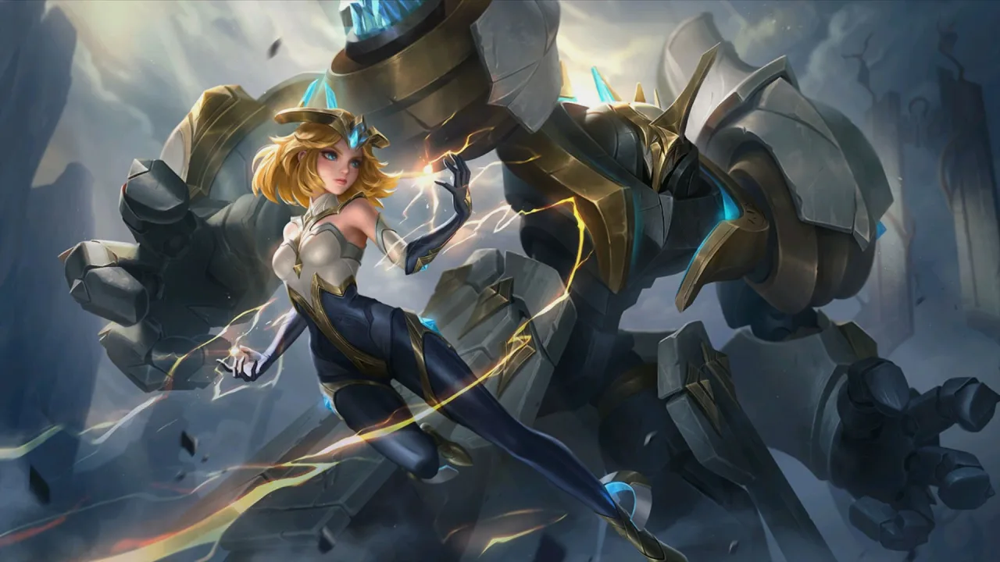

[Тир-лист](https://boostmlbb.ru/heroes/)[Предметы](https://boostmlbb.ru/items/)[Скины](https://boostmlbb.ru/skins/)[Новости и гайды](https://boostmlbb.ru/news/)

[Скины](https://boostmlbb.ru/skins/)/Эдит

# Скины Эдит

Скинов

5

Можно купить

2

Последний

[Призмати­ческая часовая](https://boostmlbb.ru/skins/edith/prismatic-sentinel.html)2025

[Профиль героя→](https://boostmlbb.ru/heroes/edith.html)

## Все скины

[Призмати­ческая часоваяИсключительный · 2025](https://boostmlbb.ru/skins/edith/prismatic-sentinel.html)[Красный бастионИзысканный · 2024](https://boostmlbb.ru/skins/edith/red-bastion.html)[Эдит «За облаками»Изысканный · 2024](https://boostmlbb.ru/skins/edith/beyond-the-clouds-edith.html)[Древняя стражницаИсключительный · 2023](https://boostmlbb.ru/skins/edith/ancient-warden.html)[Небесная защитницаОбычный · 2021](https://boostmlbb.ru/skins/edith/celestial-safeguard.html)

**Поднимем ранг на герое Эдит**Цена считается в калькуляторе

[Рассчитать цену](https://boostmlbb.ru/order.html?type=hero)

## Частые вопросы

Сколько скинов у Эдит?

5 скинов без стандартного облика. Последний — «Призматическая часовая» (Prismatic Sentinel), 3 апреля 2025.

Какие скины Эдит можно купить сейчас?

«Призматическая часовая» (749 алмазов), «Небесная защитница» (269 алмазов). Остальные облики ограниченные и возвращаются только в событиях.

Какой самый редкий скин Эдит?

«Красный бастион» (Red Bastion), класс изысканный, серия «Коллекционный». Главный приз розыгрыша в коллекционном событии, попытки покупаются за алмазы. Ограниченные облики иногда возвращаются в розыгрышах событий.
