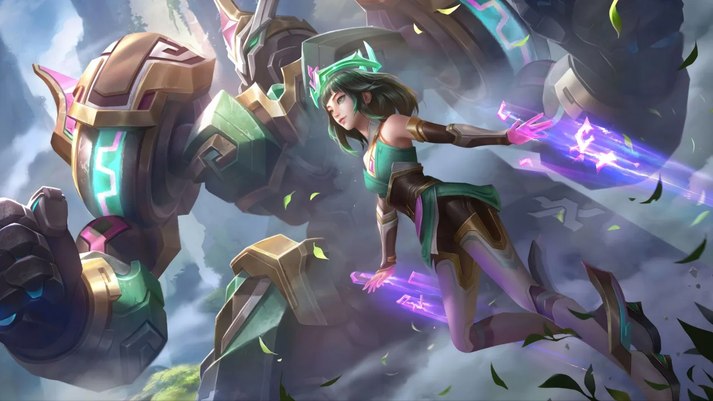

[Скины Эдит](https://boostmlbb.ru/skins/edith.html)

[Скины](https://boostmlbb.ru/skins/)/[Эдит](https://boostmlbb.ru/skins/edith.html)/Древняя стражница

[Скин Эдит](https://boostmlbb.ru/skins/edith.html)

# Древняя стражница

Ancient Warden

Исключительный ExceptionalЗвёздный участникОграниченный

Как получить

Награда «Звёздного участника» в апреле 2023.

Вышел

апрель 2023

## Что меняет облик

-   Новая внешность
-   Новые эффекты навыков
-   Анимация показа
-   Сцена показа
-   Бонус к характеристикам

## Все скины Эдит [5](https://boostmlbb.ru/skins/edith.html)

[Призмати­ческая часоваяИсключительный · 2025](https://boostmlbb.ru/skins/edith/prismatic-sentinel.html)[Красный бастионИзысканный · 2024](https://boostmlbb.ru/skins/edith/red-bastion.html)[Эдит «За облаками»Изысканный · 2024](https://boostmlbb.ru/skins/edith/beyond-the-clouds-edith.html)[Древняя стражницаИсключительный · 2023](https://boostmlbb.ru/skins/edith/ancient-warden.html)[Небесная защитницаОбычный · 2021](https://boostmlbb.ru/skins/edith/celestial-safeguard.html)

## Серия «Звёздный участник»

[Морячка, рождённая приливомКалеа · 2026](https://boostmlbb.ru/skins/kalea/tideborn-sailor.html)[Тень кицунэХаябуса · 2026](https://boostmlbb.ru/skins/hayabusa/kitsune-s-shadow.html)[Клыки резниХанзо · 2026](https://boostmlbb.ru/skins/hanzo/fangs-of-slaughter.html)[Тлеющая крепостьБелерик · 2026](https://boostmlbb.ru/skins/belerick/smouldering-fortress.html)[Магитех­нический призракОбсидия · 2026](https://boostmlbb.ru/skins/obsidia/magitech-wraith.html)[Элизийское сияниеЦзэтянь · 2026](https://boostmlbb.ru/skins/zetian/elysian-luminance.html)[Батальон стражейХильда · 2026](https://boostmlbb.ru/skins/hilda/guardian-battalion.html)[Мечта­тельный коиХарли · 2026](https://boostmlbb.ru/skins/harley/dreaming-koi.html)

**Сколько стоит буст на герое Эдит?**Выберите текущий и желаемый ранг. Стоимость появится на сайте.

[Рассчитать цену](https://boostmlbb.ru/order.html?type=hero)

## Частые вопросы

Как получить скин «Древняя стражница» на Эдит?

Награда «Звёздного участника» в апреле 2023.

Когда вышел скин «Древняя стражница»?

Апрель 2023.

Какой класс у скина «Древняя стражница»?

Исключительный (Exceptional), серия «Звёздный участник».
