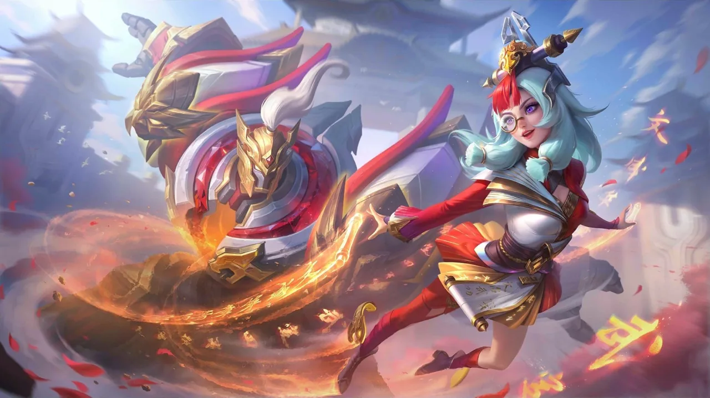

[Тир-лист](https://boostmlbb.ru/heroes/)[Предметы](https://boostmlbb.ru/items/)[Скины](https://boostmlbb.ru/skins/)[Новости и гайды](https://boostmlbb.ru/news/)

[Скины](https://boostmlbb.ru/skins/)/[Эдит](https://boostmlbb.ru/skins/edith.html)/Красный бастион

[Скин Эдит](https://boostmlbb.ru/skins/edith.html)

# Красный бастион

Red Bastion

Изысканный ExquisiteКоллекционныйОграниченный

Как получить

Главный приз розыгрыша в коллекционном событии, попытки покупаются за алмазы. Ограниченные облики иногда возвращаются в розыгрышах событий.

Вышел

апрель 2024

## Что меняет облик

-   Новая внешность
-   Новые эффекты навыков
-   Звуки навыков
-   Своя озвучка
-   Анимация показа
-   Сцена показа
-   Музыка показа
-   Особые действия
-   Бонус к характеристикам

## Все скины Эдит [5](https://boostmlbb.ru/skins/edith.html)

[Призмати­ческая часоваяИсключительный · 2025](https://boostmlbb.ru/skins/edith/prismatic-sentinel.html)[Красный бастионИзысканный · 2024](https://boostmlbb.ru/skins/edith/red-bastion.html)[Эдит «За облаками»Изысканный · 2024](https://boostmlbb.ru/skins/edith/beyond-the-clouds-edith.html)[Древняя стражницаИсключительный · 2023](https://boostmlbb.ru/skins/edith/ancient-warden.html)[Небесная защитницаОбычный · 2021](https://boostmlbb.ru/skins/edith/celestial-safeguard.html)

## Серия «Коллекционный»

[ОчистительБруно · 2026](https://boostmlbb.ru/skins/bruno/the-purifier.html)[Небесный бунтарьСан · 2026](https://boostmlbb.ru/skins/sun/celestial-rebel.html)[Кайдзю глубинХелкарт · 2026](https://boostmlbb.ru/skins/helcurt/kaiju-of-the-deep.html)[Звёздный дозорныйКимми · 2026](https://boostmlbb.ru/skins/kimmy/starbound-sentry.html)[Монархиня грёзАлиса · 2026](https://boostmlbb.ru/skins/alice/dreaming-monarch.html)[Дрожь глубинГрок · 2026](https://boostmlbb.ru/skins/grock/tremor-of-the-deep.html)[Небесный генералТигрил · 2026](https://boostmlbb.ru/skins/tigreal/celestial-general.html)[Монарх, рождённый солнцемКсавьер · 2026](https://boostmlbb.ru/skins/xavier/sunborn-monarch.html)

**Поднимем ранг на герое Эдит**Цена считается в калькуляторе

[Рассчитать цену](https://boostmlbb.ru/order.html?type=hero)

## Частые вопросы

Как получить скин «Красный бастион» на Эдит?

Главный приз розыгрыша в коллекционном событии, попытки покупаются за алмазы. Ограниченные облики иногда возвращаются в розыгрышах событий.

Когда вышел скин «Красный бастион»?

Апрель 2024.

Какой класс у скина «Красный бастион»?

Изысканный (Exquisite), серия «Коллекционный».
