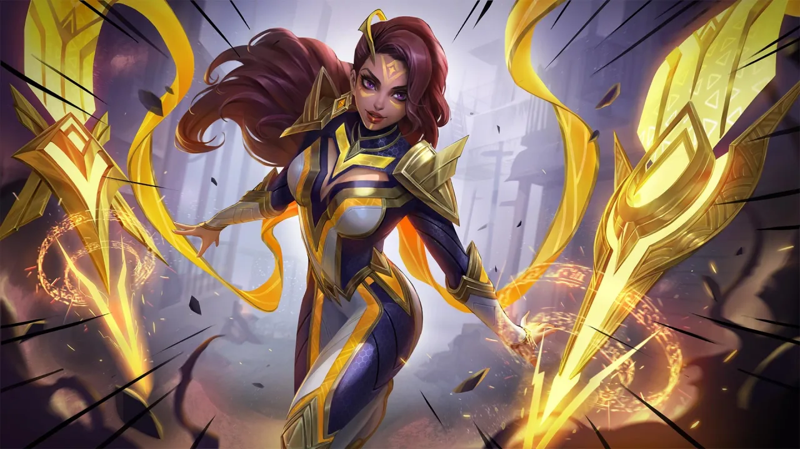

[Тир-лист](https://boostmlbb.ru/heroes/)[Предметы](https://boostmlbb.ru/items/)[Скины](https://boostmlbb.ru/skins/)[Новости и гайды](https://boostmlbb.ru/news/)

[Скины](https://boostmlbb.ru/skins/)/[Эсмеральда](https://boostmlbb.ru/skins/esmeralda.html)/Прорицательница

[Скин Эсмеральды](https://boostmlbb.ru/skins/esmeralda.html)

# Прорицательница

The Foreseer

Грандиозный GrandВосходящие звёздыОграниченный

Как получить

Выходил в событии «Восходящие звёзды». Ограниченные облики иногда возвращаются в розыгрышах событий.

Вышел

2023 год

## Что меняет облик

-   Новая внешность
-   Новые эффекты навыков
-   Звуки навыков
-   Своя озвучка
-   Анимация показа
-   Сцена показа
-   Бонус к характеристикам

## Все скины Эсмеральды [8](https://boostmlbb.ru/skins/esmeralda.html)

[Астральная музаИсключительный · 2025](https://boostmlbb.ru/skins/esmeralda/astral-muse.html)[Прорица­тельницаГрандиозный · 2023](https://boostmlbb.ru/skins/esmeralda/the-foreseer.html)[Посланница светаИзысканный · 2022](https://boostmlbb.ru/skins/esmeralda/light-envoy.html)[Пылающая теньДелюкс · 2020](https://boostmlbb.ru/skins/esmeralda/blazing-shadow.html)[КлеопатраИсключительный · 2020](https://boostmlbb.ru/skins/esmeralda/cleopatra.html)[Леди-воровкаИсключительный · 2020](https://boostmlbb.ru/skins/esmeralda/lady-thief.html)[Ядовитая лозаОбычный · 2019](https://boostmlbb.ru/skins/esmeralda/poison-vine.html)[Багряные сумеркиОбычный · 2019](https://boostmlbb.ru/skins/esmeralda/ruddy-dusk.html)

## Серия «Восходящие звёзды»

[Мастер мечаЛанселот · 2024](https://boostmlbb.ru/skins/lancelot/swordmaster.html)[Снежная буряВэйл · 2023](https://boostmlbb.ru/skins/vale/blizzard-storm.html)[Громовой кулакЧу · 2021](https://boostmlbb.ru/skins/chou/thunderfist.html)[Огненный разрядБруно · 2020](https://boostmlbb.ru/skins/bruno/firebolt.html)

**Поднимем ранг на герое Эсмеральда**Цена считается в калькуляторе

[Рассчитать цену](https://boostmlbb.ru/order.html?type=hero)

## Частые вопросы

Как получить скин «Прорицательница» на Эсмеральду?

Выходил в событии «Восходящие звёзды». Ограниченные облики иногда возвращаются в розыгрышах событий.

Когда вышел скин «Прорицательница»?

2023 год.

Какой класс у скина «Прорицательница»?

Грандиозный (Grand), серия «Восходящие звёзды».
