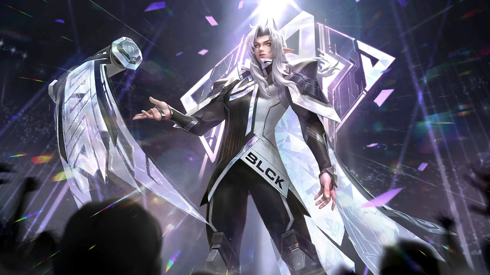

[Скины Эстеса](https://boostmlbb.ru/skins/estes.html)

[Скины](https://boostmlbb.ru/skins/)/[Эстес](https://boostmlbb.ru/skins/estes.html)/Blacklist International

[Скин Эстеса](https://boostmlbb.ru/skins/estes.html)

# Blacklist International

Делюкс DeluxeЧемпионскийОграниченный

Как получить

Киберспортивный облик (Чемпионский): выходил в событии турнира. Ограниченные облики иногда возвращаются в розыгрышах событий.

Вышел

16 марта 2024

## Что меняет облик

-   Новая внешность
-   Новые эффекты навыков
-   Звуки навыков
-   Анимация показа
-   Сцена показа
-   Музыка показа
-   Бонус к характеристикам

## Все скины Эстеса [8](https://boostmlbb.ru/skins/estes.html)

[Тайный магистратИсключительный · 2025](https://boostmlbb.ru/skins/estes/arcane-magistrate.html)[Эстес SPARKLEДелюкс · 2024](https://boostmlbb.ru/skins/estes/sparkle-estes.html)[Blacklist Interna­tionalДелюкс · 2024](https://boostmlbb.ru/skins/estes/blacklist-international.html)[Епископ-воронИсключительный · 2020](https://boostmlbb.ru/skins/estes/crow-bishop.html)[Белый журавльОбычный · 2018](https://boostmlbb.ru/skins/estes/white-crane.html)[Повелитель галактикиИзысканный](https://boostmlbb.ru/skins/estes/galaxy-dominator.html)[Ротанговый драконДелюкс · 2017](https://boostmlbb.ru/skins/estes/rattan-dragon.html)[Святой жрецОбычный · 2017](https://boostmlbb.ru/skins/estes/holy-priest.html)

## Серия «Чемпионский»

[EVOS LegendsХарит · 2025](https://boostmlbb.ru/skins/harith/evos-legends.html)[APBrenБроуди · 2024](https://boostmlbb.ru/skins/brody/apbren.html)[ECHOЧу · 2023](https://boostmlbb.ru/skins/chou/echo.html)[Bren EsportsЛанселот · 2020](https://boostmlbb.ru/skins/lancelot/bren-esports.html)

**Сколько стоит буст на герое Эстес?**Выберите текущий и желаемый ранг. Стоимость появится на сайте.

[Рассчитать цену](https://boostmlbb.ru/order.html?type=hero)

## Частые вопросы

Как получить скин «Blacklist International» на Эстеса?

Киберспортивный облик (Чемпионский): выходил в событии турнира. Ограниченные облики иногда возвращаются в розыгрышах событий.

Когда вышел скин «Blacklist International»?

16 марта 2024.

Какой класс у скина «Blacklist International»?

Делюкс (Deluxe), серия «Чемпионский».
