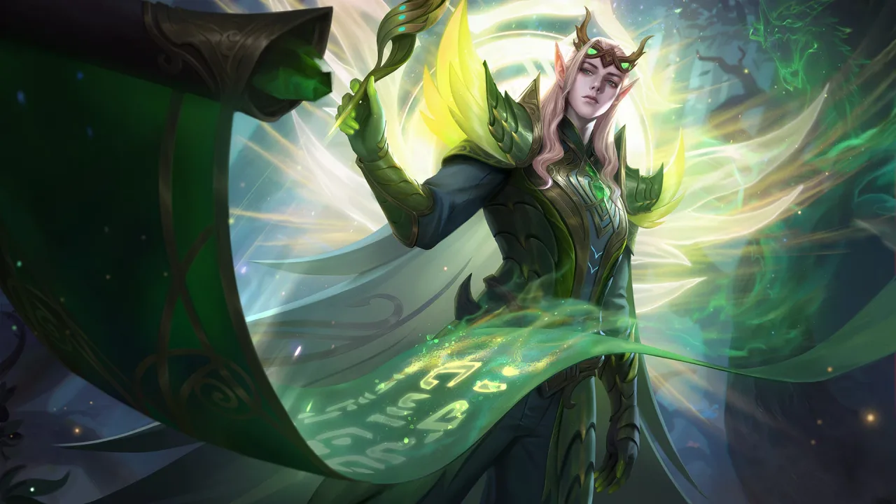

[Скины Эстеса](https://boostmlbb.ru/skins/estes.html)

[Скины](https://boostmlbb.ru/skins/)/[Эстес](https://boostmlbb.ru/skins/estes.html)/Ротанговый дракон

[Скин Эстеса](https://boostmlbb.ru/skins/estes.html)

# Ротанговый дракон

Rattan Dragon

Делюкс DeluxeУкротители драконовВ продаже

Как получить

Продаётся в магазине обликов за 899 алмазов.

Цена

899 алмазов

Вышел

2 ноября 2017

## Что меняет облик

-   Новая внешность
-   Новые эффекты навыков
-   Анимация показа
-   Сцена показа
-   Бонус к характеристикам

## Все скины Эстеса [8](https://boostmlbb.ru/skins/estes.html)

[Тайный магистратИсключительный · 2025](https://boostmlbb.ru/skins/estes/arcane-magistrate.html)[Эстес SPARKLEДелюкс · 2024](https://boostmlbb.ru/skins/estes/sparkle-estes.html)[Blacklist Interna­tionalДелюкс · 2024](https://boostmlbb.ru/skins/estes/blacklist-international.html)[Епископ-воронИсключительный · 2020](https://boostmlbb.ru/skins/estes/crow-bishop.html)[Белый журавльОбычный · 2018](https://boostmlbb.ru/skins/estes/white-crane.html)[Повелитель галактикиИзысканный](https://boostmlbb.ru/skins/estes/galaxy-dominator.html)[Ротанговый драконДелюкс · 2017](https://boostmlbb.ru/skins/estes/rattan-dragon.html)[Святой жрецОбычный · 2017](https://boostmlbb.ru/skins/estes/holy-priest.html)

## Серия «Укротители драконов»

[Морозное крылоКимми · 2025](https://boostmlbb.ru/skins/kimmy/frost-wing.html)[Ночная теньЛинг · 2024](https://boostmlbb.ru/skins/ling/night-shade.html)[Небесное пламяЛанселот · 2021](https://boostmlbb.ru/skins/lancelot/empyrean-flame.html)[Драконья броняМаша · 2020](https://boostmlbb.ru/skins/masha/dragon-armor.html)[Драконье пламяВалир · 2019](https://boostmlbb.ru/skins/valir/draconic-flame.html)

**Сколько стоит буст на герое Эстес?**Выберите текущий и желаемый ранг. Стоимость появится на сайте.

[Рассчитать цену](https://boostmlbb.ru/order.html?type=hero)

## Частые вопросы

Как получить скин «Ротанговый дракон» на Эстеса?

Продаётся в магазине обликов за 899 алмазов.

Когда вышел скин «Ротанговый дракон»?

2 ноября 2017.

Какой класс у скина «Ротанговый дракон»?

Делюкс (Deluxe), серия «Укротители драконов».
