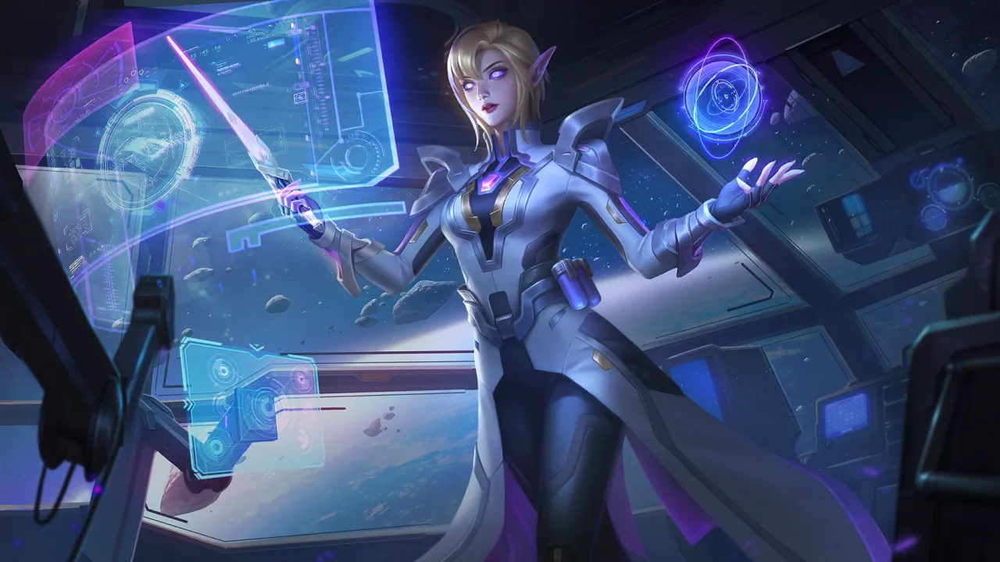

[Тир-лист](https://boostmlbb.ru/heroes/)[Предметы](https://boostmlbb.ru/items/)[Скины](https://boostmlbb.ru/skins/)[Новости и гайды](https://boostmlbb.ru/news/)

[Скины](https://boostmlbb.ru/skins/)/[Эйдора](https://boostmlbb.ru/skins/eudora.html)/Космическое путешествие

[Скин Эйдоры](https://boostmlbb.ru/skins/eudora.html)

# Космическое путешествие

Cosmic Voyage

Исключительный ExceptionalЗвёздный участникОграниченный

Как получить

Награда «Звёздного участника» в октябре 2022.

Вышел

1 октября 2022

## Что меняет облик

-   Новая внешность
-   Новые эффекты навыков
-   Анимация показа
-   Бонус к характеристикам

## Все скины Эйдоры [8](https://boostmlbb.ru/skins/eudora.html)

[Чары полуночиДелюкс · 2026](https://boostmlbb.ru/skins/eudora/midnight-s-allure.html)[Эйдора Atomic PopДелюкс · 2023](https://boostmlbb.ru/skins/eudora/atomic-pop-eudora.html)[Косми­ческое путе­шествиеИсключительный · 2022](https://boostmlbb.ru/skins/eudora/cosmic-voyage.html)[Графиня СкарлетОбычный · 2020](https://boostmlbb.ru/skins/eudora/countess-scarlet.html)[Богиня селфи VivoИсключительный · 2017](https://boostmlbb.ru/skins/eudora/vivo-selfie-goddess.html)[Изумрудная чародейкаИзысканный · 2017](https://boostmlbb.ru/skins/eudora/emerald-enchantress.html)[Рож­дественский карнавалИсключительный · 2016](https://boostmlbb.ru/skins/eudora/christmas-carnival.html)[Огненно-алые губыОбычный · 2016](https://boostmlbb.ru/skins/eudora/flame-red-lips.html)

## Серия «Звёздный участник»

[Морячка, рождённая приливомКалеа · 2026](https://boostmlbb.ru/skins/kalea/tideborn-sailor.html)[Тень кицунэХаябуса · 2026](https://boostmlbb.ru/skins/hayabusa/kitsune-s-shadow.html)[Клыки резниХанзо · 2026](https://boostmlbb.ru/skins/hanzo/fangs-of-slaughter.html)[Тлеющая крепостьБелерик · 2026](https://boostmlbb.ru/skins/belerick/smouldering-fortress.html)[Магитех­нический призракОбсидия · 2026](https://boostmlbb.ru/skins/obsidia/magitech-wraith.html)[Элизийское сияниеЦзэтянь · 2026](https://boostmlbb.ru/skins/zetian/elysian-luminance.html)[Батальон стражейХильда · 2026](https://boostmlbb.ru/skins/hilda/guardian-battalion.html)[Мечта­тельный коиХарли · 2026](https://boostmlbb.ru/skins/harley/dreaming-koi.html)

**Поднимем ранг на герое Эйдора**Цена считается в калькуляторе

[Рассчитать цену](https://boostmlbb.ru/order.html?type=hero)

## Частые вопросы

Как получить скин «Космическое путешествие» на Эйдору?

Награда «Звёздного участника» в октябре 2022.

Когда вышел скин «Космическое путешествие»?

1 октября 2022.

Какой класс у скина «Космическое путешествие»?

Исключительный (Exceptional), серия «Звёздный участник».
