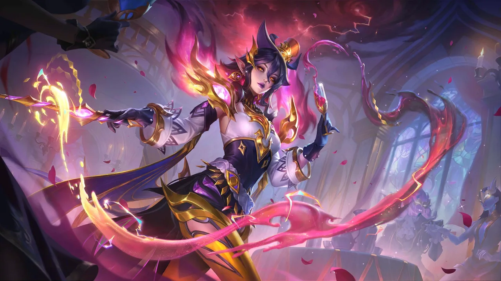
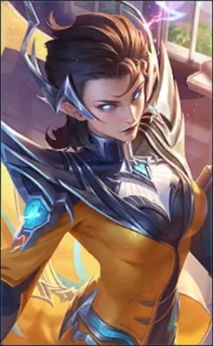

[Скины Эйдоры](https://boostmlbb.ru/skins/eudora.html)

[Скины](https://boostmlbb.ru/skins/)/[Эйдора](https://boostmlbb.ru/skins/eudora.html)/Чары полуночи

[Скин Эйдоры](https://boostmlbb.ru/skins/eudora.html)

# Чары полуночи

Midnight's Allure

Делюкс DeluxeЗаветОграниченный

Как получить

Выходил в событии «Завет». Ограниченные облики иногда возвращаются в розыгрышах событий.

Вышел

11 февраля 2026

## Что меняет облик

-   Новая внешность
-   Новые эффекты навыков
-   Звуки навыков
-   Своя озвучка
-   Анимация показа
-   Сцена показа
-   Музыка показа
-   Бонус к характеристикам

## Все скины Эйдоры [8](https://boostmlbb.ru/skins/eudora.html)

[Чары полуночиДелюкс · 2026](https://boostmlbb.ru/skins/eudora/midnight-s-allure.html)[Эйдора Atomic PopДелюкс · 2023](https://boostmlbb.ru/skins/eudora/atomic-pop-eudora.html)[Косми­ческое путе­шествиеИсключительный · 2022](https://boostmlbb.ru/skins/eudora/cosmic-voyage.html)[Графиня СкарлетОбычный · 2020](https://boostmlbb.ru/skins/eudora/countess-scarlet.html)[Богиня селфи VivoИсключительный · 2017](https://boostmlbb.ru/skins/eudora/vivo-selfie-goddess.html)[Изумрудная чародейкаИзысканный · 2017](https://boostmlbb.ru/skins/eudora/emerald-enchantress.html)[Рож­дественский карнавалИсключительный · 2016](https://boostmlbb.ru/skins/eudora/christmas-carnival.html)[Огненно-алые губыОбычный · 2016](https://boostmlbb.ru/skins/eudora/flame-red-lips.html)

## Серия «Завет»

[Призрачное весельеЛилия · 2026](https://boostmlbb.ru/skins/lylia/phantasmal-revelry.html)[Кровавый распоря­дительНатан · 2026](https://boostmlbb.ru/skins/natan/sanguine-steward.html)[Призрачный миражБенедетта · 2025](https://boostmlbb.ru/skins/benedetta/phantom-mirage.html)[Герцогиня приливовЛесли · 2025](https://boostmlbb.ru/skins/lesley/duchess-of-tides.html)

**Сколько стоит буст на герое Эйдора?**Выберите текущий и желаемый ранг. Стоимость появится на сайте.

[Рассчитать цену](https://boostmlbb.ru/order.html?type=hero)

## Частые вопросы

Как получить скин «Чары полуночи» на Эйдору?

Выходил в событии «Завет». Ограниченные облики иногда возвращаются в розыгрышах событий.

Когда вышел скин «Чары полуночи»?

11 февраля 2026.

Какой класс у скина «Чары полуночи»?

Делюкс (Deluxe), серия «Завет».
