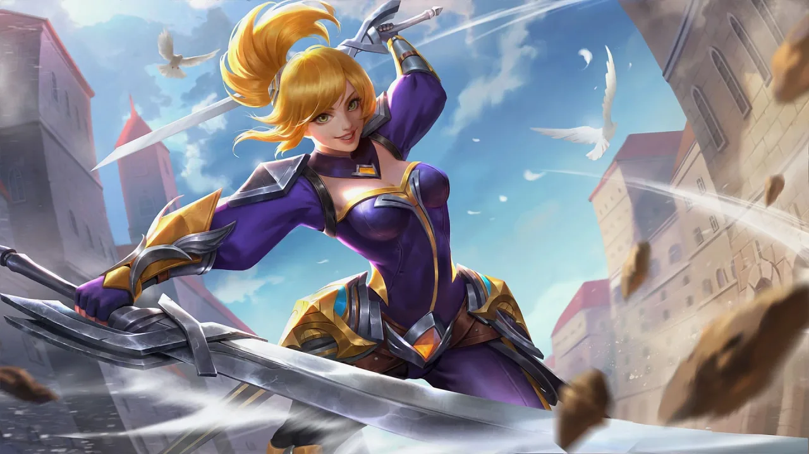

[Тир-лист](https://boostmlbb.ru/heroes/)[Предметы](https://boostmlbb.ru/items/)[Скины](https://boostmlbb.ru/skins/)[Новости и гайды](https://boostmlbb.ru/news/)

[Скины](https://boostmlbb.ru/skins/)/Фанни

# Скины Фанни

Скинов

13

Можно купить

3

Последний

[Фанни P.ACE](https://boostmlbb.ru/skins/fanny/p-ace-fanny.html)2025

[Профиль героя→](https://boostmlbb.ru/heroes/fanny.html)

## Все скины

ВсеГрандиозныйИзысканныйДелюксИсключительныйОбычный

[Фанни P.ACEДелюкс · 2025](https://boostmlbb.ru/skins/fanny/p-ace-fanny.html)[МикасаГрандиозный · 2023](https://boostmlbb.ru/skins/fanny/mikasa.html)[Парящее сердцеДелюкс · 2022](https://boostmlbb.ru/skins/fanny/heart-afloat.html)[Клинок надеждыГрандиозный · 2022](https://boostmlbb.ru/skins/fanny/blade-of-kibou.html)[Имперская вои­тельницаОбычный · 2021](https://boostmlbb.ru/skins/fanny/imperial-warrior.html)[Рож­дественский карнавалИсключительный · 2020](https://boostmlbb.ru/skins/fanny/christmas-carnival.html)[Рождённая светом: РейнджерДелюкс · 2019](https://boostmlbb.ru/skins/fanny/lightborn-ranger.html)[Спаса­тельницаИсключительный · 2019](https://boostmlbb.ru/skins/fanny/lifeguard.html)[Коро­левская кавалерияИсключительный · 2018](https://boostmlbb.ru/skins/fanny/royal-cavalry.html)[ЖаворонокИзысканный · 2018](https://boostmlbb.ru/skins/fanny/skylark.html)[Принцесса-панкОбычный · 2017](https://boostmlbb.ru/skins/fanny/punk-princess.html)[СтуденткаОбычный · 2016](https://boostmlbb.ru/skins/fanny/campus-youth.html)[Галакти­ческий звёздный ястреб](https://boostmlbb.ru/skins/fanny/galactic-starhawk.html)

**Поднимем ранг на герое Фанни**Цена считается в калькуляторе

[Рассчитать цену](https://boostmlbb.ru/order.html?type=hero)

## Частые вопросы

Сколько скинов у Фанни?

13 скинов без стандартного облика. Последний — «Фанни P.ACE» (P.ACE Fanny), 9 октября 2025.

Какие скины Фанни можно купить сейчас?

«Рождённая светом: Рейнджер» (1 089 алмазов), «Спасательница» (749 алмазов), «Студентка» (399 алмазов). Остальные облики ограниченные и возвращаются только в событиях.

Какой самый редкий скин Фанни?

«Микаса» (Mikasa), класс грандиозный, серия «Атака титанов». Выходил в событии коллаборации MLBB × Attack on Titan.
