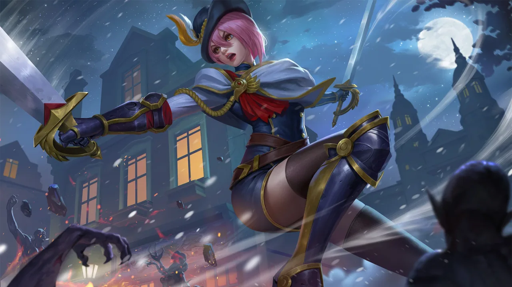

[Тир-лист](https://boostmlbb.ru/heroes/)[Предметы](https://boostmlbb.ru/items/)[Скины](https://boostmlbb.ru/skins/)[Новости и гайды](https://boostmlbb.ru/news/)

[Скины](https://boostmlbb.ru/skins/)/[Фанни](https://boostmlbb.ru/skins/fanny.html)/Королевская кавалерия

[Скин Фанни](https://boostmlbb.ru/skins/fanny.html)

# Королевская кавалерия

Royal Cavalry

Исключительный ExceptionalЗвёздный участникОграниченный

Как получить

Награда «Звёздного участника» в декабре 2018.

Вышел

1 декабря 2018

## Что меняет облик

-   Новая внешность
-   Новые эффекты навыков
-   Анимация показа
-   Бонус к характеристикам

## Все скины Фанни [13](https://boostmlbb.ru/skins/fanny.html)

[Фанни P.ACEДелюкс · 2025](https://boostmlbb.ru/skins/fanny/p-ace-fanny.html)[МикасаГрандиозный · 2023](https://boostmlbb.ru/skins/fanny/mikasa.html)[Парящее сердцеДелюкс · 2022](https://boostmlbb.ru/skins/fanny/heart-afloat.html)[Клинок надеждыГрандиозный · 2022](https://boostmlbb.ru/skins/fanny/blade-of-kibou.html)[Имперская вои­тельницаОбычный · 2021](https://boostmlbb.ru/skins/fanny/imperial-warrior.html)[Рож­дественский карнавалИсключительный · 2020](https://boostmlbb.ru/skins/fanny/christmas-carnival.html)[Рождённая светом: РейнджерДелюкс · 2019](https://boostmlbb.ru/skins/fanny/lightborn-ranger.html)[Спаса­тельницаИсключительный · 2019](https://boostmlbb.ru/skins/fanny/lifeguard.html)[Коро­левская кавалерияИсключительный · 2018](https://boostmlbb.ru/skins/fanny/royal-cavalry.html)[ЖаворонокИзысканный · 2018](https://boostmlbb.ru/skins/fanny/skylark.html)[Принцесса-панкОбычный · 2017](https://boostmlbb.ru/skins/fanny/punk-princess.html)[СтуденткаОбычный · 2016](https://boostmlbb.ru/skins/fanny/campus-youth.html)[Галакти­ческий звёздный ястреб](https://boostmlbb.ru/skins/fanny/galactic-starhawk.html)

## Серия «Звёздный участник»

[Морячка, рождённая приливомКалеа · 2026](https://boostmlbb.ru/skins/kalea/tideborn-sailor.html)[Тень кицунэХаябуса · 2026](https://boostmlbb.ru/skins/hayabusa/kitsune-s-shadow.html)[Клыки резниХанзо · 2026](https://boostmlbb.ru/skins/hanzo/fangs-of-slaughter.html)[Тлеющая крепостьБелерик · 2026](https://boostmlbb.ru/skins/belerick/smouldering-fortress.html)[Магитех­нический призракОбсидия · 2026](https://boostmlbb.ru/skins/obsidia/magitech-wraith.html)[Элизийское сияниеЦзэтянь · 2026](https://boostmlbb.ru/skins/zetian/elysian-luminance.html)[Батальон стражейХильда · 2026](https://boostmlbb.ru/skins/hilda/guardian-battalion.html)[Мечта­тельный коиХарли · 2026](https://boostmlbb.ru/skins/harley/dreaming-koi.html)

**Поднимем ранг на герое Фанни**Цена считается в калькуляторе

[Рассчитать цену](https://boostmlbb.ru/order.html?type=hero)

## Частые вопросы

Как получить скин «Королевская кавалерия» на Фанни?

Награда «Звёздного участника» в декабре 2018.

Когда вышел скин «Королевская кавалерия»?

1 декабря 2018.

Какой класс у скина «Королевская кавалерия»?

Исключительный (Exceptional), серия «Звёздный участник».
