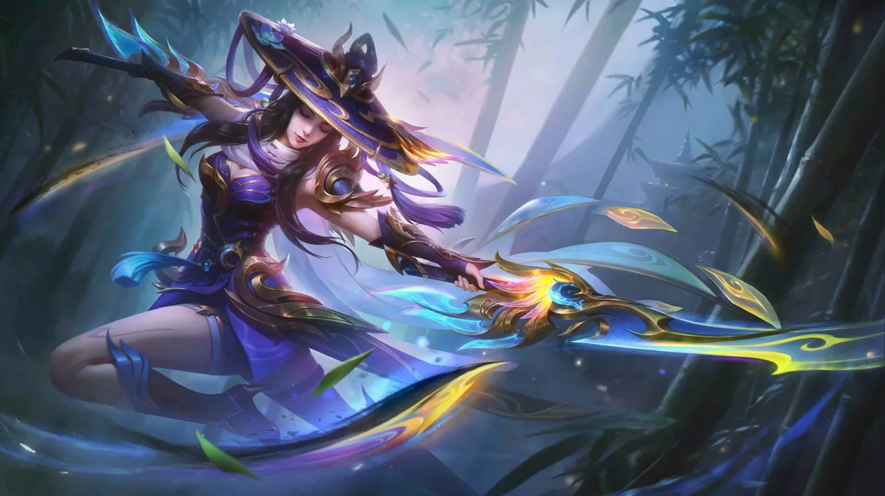

[Скины Фанни](https://boostmlbb.ru/skins/fanny.html)

[Скины](https://boostmlbb.ru/skins/)/[Фанни](https://boostmlbb.ru/skins/fanny.html)/Жаворонок

[Скин Фанни](https://boostmlbb.ru/skins/fanny.html)

# Жаворонок

Skylark

Изысканный ExquisiteЯщик удачиОграниченный

Как получить

Выпадал из ящиков удачи в событиях. Ограниченные облики иногда возвращаются в розыгрышах событий.

Вышел

2018 год

## Что меняет облик

-   Новая внешность
-   Новые эффекты навыков
-   Анимация показа
-   Сцена показа
-   Бонус к характеристикам

## Все скины Фанни [13](https://boostmlbb.ru/skins/fanny.html)

[Фанни P.ACEДелюкс · 2025](https://boostmlbb.ru/skins/fanny/p-ace-fanny.html)[МикасаГрандиозный · 2023](https://boostmlbb.ru/skins/fanny/mikasa.html)[Парящее сердцеДелюкс · 2022](https://boostmlbb.ru/skins/fanny/heart-afloat.html)[Клинок надеждыГрандиозный · 2022](https://boostmlbb.ru/skins/fanny/blade-of-kibou.html)[Имперская вои­тельницаОбычный · 2021](https://boostmlbb.ru/skins/fanny/imperial-warrior.html)[Рож­дественский карнавалИсключительный · 2020](https://boostmlbb.ru/skins/fanny/christmas-carnival.html)[Рождённая светом: РейнджерДелюкс · 2019](https://boostmlbb.ru/skins/fanny/lightborn-ranger.html)[Спаса­тельницаИсключительный · 2019](https://boostmlbb.ru/skins/fanny/lifeguard.html)[Коро­левская кавалерияИсключительный · 2018](https://boostmlbb.ru/skins/fanny/royal-cavalry.html)[ЖаворонокИзысканный · 2018](https://boostmlbb.ru/skins/fanny/skylark.html)[Принцесса-панкОбычный · 2017](https://boostmlbb.ru/skins/fanny/punk-princess.html)[СтуденткаОбычный · 2016](https://boostmlbb.ru/skins/fanny/campus-youth.html)[Галакти­ческий звёздный ястреб](https://boostmlbb.ru/skins/fanny/galactic-starhawk.html)

## Серия «Ящик удачи»

[Леди-журавльГвиневра · 2025](https://boostmlbb.ru/skins/guinevere/lady-crane.html)[Серафим-бабочкаЛюнокс · 2025](https://boostmlbb.ru/skins/lunox/butterfly-seraphim.html)[МехадраконКлауд · 2025](https://boostmlbb.ru/skins/claude/mecha-dragon.html)[Лунная магияЧан'Э · 2020](https://boostmlbb.ru/skins/change/lunar-magic.html)[Громовая вспышкаСелена · 2020](https://boostmlbb.ru/skins/selena/thunder-flash.html)[РакшасаХанаби · 2020](https://boostmlbb.ru/skins/hanabi/rakshesha.html)[Повелитель видеоигрУранус · 2020](https://boostmlbb.ru/skins/uranus/video-game-dominator.html)[Бог войныМартис · 2020](https://boostmlbb.ru/skins/martis/god-of-war.html)

**Сколько стоит буст на герое Фанни?**Выберите текущий и желаемый ранг. Стоимость появится на сайте.

[Рассчитать цену](https://boostmlbb.ru/order.html?type=hero)

## Частые вопросы

Как получить скин «Жаворонок» на Фанни?

Выпадал из ящиков удачи в событиях. Ограниченные облики иногда возвращаются в розыгрышах событий.

Когда вышел скин «Жаворонок»?

2018 год.

Какой класс у скина «Жаворонок»?

Изысканный (Exquisite), серия «Ящик удачи».
