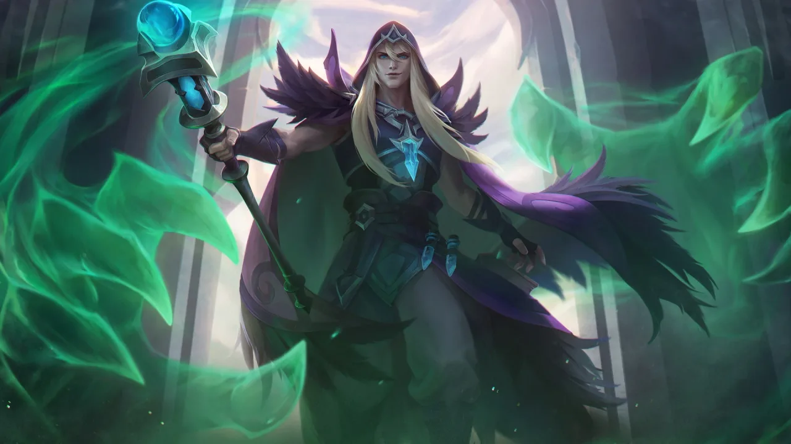
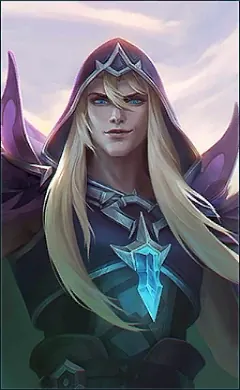

[Скины Фарамиса](https://boostmlbb.ru/skins/faramis.html)

[Скины](https://boostmlbb.ru/skins/)/[Фарамис](https://boostmlbb.ru/skins/faramis.html)/Тёмный некромант

[Скин Фарамиса](https://boostmlbb.ru/skins/faramis.html)

# Тёмный некромант

Dark Necro

Обычный CommonВ продаже

Как получить

Продаётся в магазине обликов за 269 алмазов.

Цена

269 алмазов

Вышел

18 мая 2019

## Что меняет облик

-   Бонус к характеристикам

## Все скины Фарамиса [5](https://boostmlbb.ru/skins/faramis.html)

[Загадочный путникОбычный · 2025](https://boostmlbb.ru/skins/faramis/enigmatic-wayfarer.html)[Тёмный некромантОбычный · 2019](https://boostmlbb.ru/skins/faramis/dark-necro.html)[Адский магистрДелюкс · 2018](https://boostmlbb.ru/skins/faramis/infernal-magister.html)[Летние искрыИсключительный · 2018](https://boostmlbb.ru/skins/faramis/summer-sparks.html)[Коро­левский магОбычный · 2018](https://boostmlbb.ru/skins/faramis/royal-magus.html)

**Сколько стоит буст на герое Фарамис?**Выберите текущий и желаемый ранг. Стоимость появится на сайте.

[Рассчитать цену](https://boostmlbb.ru/order.html?type=hero)

## Частые вопросы

Как получить скин «Тёмный некромант» на Фарамиса?

Продаётся в магазине обликов за 269 алмазов.

Когда вышел скин «Тёмный некромант»?

18 мая 2019.

Какой класс у скина «Тёмный некромант»?

Обычный (Common).
