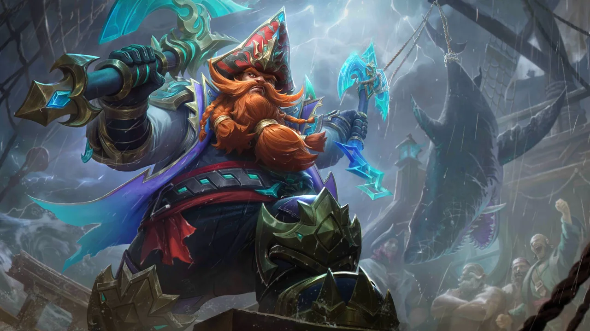

[Скины Франко](https://boostmlbb.ru/skins/franco.html)

[Скины](https://boostmlbb.ru/skins/)/[Франко](https://boostmlbb.ru/skins/franco.html)/Капитан потерянных

[Скин Франко](https://boostmlbb.ru/skins/franco.html)

# Капитан потерянных

Captain of the Lost

Исключительный ExceptionalОсобыйОграниченный

Как получить

Выходил в магазине обликов во время события. Ограниченные облики иногда возвращаются в розыгрышах событий.

Вышел

19 февраля 2026

## Что меняет облик

-   Новая внешность
-   Новые эффекты навыков
-   Анимация показа
-   Бонус к характеристикам

## Все скины Франко [10](https://boostmlbb.ru/skins/franco.html)

[Капитан потерянныхИсключительный · 2026](https://boostmlbb.ru/skins/franco/captain-of-the-lost.html)[Квантовый авангардИсключительный · 2024](https://boostmlbb.ru/skins/franco/quantum-vanguard.html)[Король адаВысший · 2023](https://boostmlbb.ru/skins/franco/king-of-hell.html)[КостоломОбычный · 2021](https://boostmlbb.ru/skins/franco/bone-crusher.html)[Пылающий топорДелюкс · 2020](https://boostmlbb.ru/skins/franco/blazing-axe.html)[Владыка ВальгаллыИзысканный · 2020](https://boostmlbb.ru/skins/franco/valhalla-ruler.html)[Кошмар пшеничного поляИсключительный · 2019](https://boostmlbb.ru/skins/franco/wheatfield-nightmare.html)[ЛокомотивОбычный · 2018](https://boostmlbb.ru/skins/franco/locomotive.html)[Апока­липсисИсключительный · 2017](https://boostmlbb.ru/skins/franco/apocalypse.html)[Шеф-поварИсключительный · 2016](https://boostmlbb.ru/skins/franco/masterchef.html)

## Серия «Особый»

[Тайный вердиктМатильда · 2026](https://boostmlbb.ru/skins/mathilda/arcane-verdict.html)[Вальс на ветруВэйл · 2026](https://boostmlbb.ru/skins/vale/windborne-waltz.html)[ВолнорезЛи Сун-Син · 2025](https://boostmlbb.ru/skins/yi-sun-shin/wavebreaker.html)[Стальные рукиБаданг · 2025](https://boostmlbb.ru/skins/badang/steel-arms.html)[Леди с зонтикомКагура · 2025](https://boostmlbb.ru/skins/kagura/lady-parasol.html)[Ужас пучиныАлдос · 2025](https://boostmlbb.ru/skins/aldous/fathom-terror.html)[Труппа лунного светаЧан'Э · 2025](https://boostmlbb.ru/skins/change/moonglow-troupe.html)[Тайный магистратЭстес · 2025](https://boostmlbb.ru/skins/estes/arcane-magistrate.html)

**Сколько стоит буст на герое Франко?**Выберите текущий и желаемый ранг. Стоимость появится на сайте.

[Рассчитать цену](https://boostmlbb.ru/order.html?type=hero)

## Частые вопросы

Как получить скин «Капитан потерянных» на Франко?

Выходил в магазине обликов во время события. Ограниченные облики иногда возвращаются в розыгрышах событий.

Когда вышел скин «Капитан потерянных»?

19 февраля 2026.

Какой класс у скина «Капитан потерянных»?

Исключительный (Exceptional), серия «Особый».
