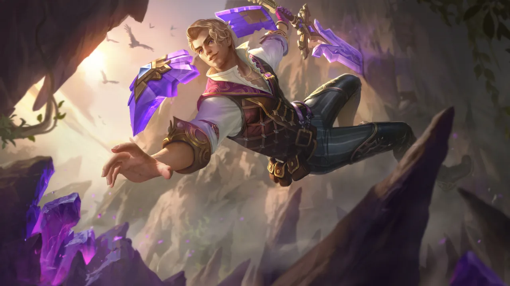

[Скины Фредрина](https://boostmlbb.ru/skins/fredrinn.html)

[Скины](https://boostmlbb.ru/skins/)/[Фредрин](https://boostmlbb.ru/skins/fredrinn.html)/Знаток драгоценностей

[Скин Фредрина](https://boostmlbb.ru/skins/fredrinn.html)

# Знаток драгоценностей

Jewel Connoisseur

Обычный CommonЭлитныйВ продаже

Как получить

Продаётся в магазине обликов за 599 алмазов.

Цена

599 алмазов

Вышел

2023 год

## Что меняет облик

-   Новая внешность
-   Другой цвет эффектов
-   Анимация показа
-   Бонус к характеристикам

## Все скины Фредрина [5](https://boostmlbb.ru/skins/fredrinn.html)

[Коро­левский маршалИсключительный · 2025](https://boostmlbb.ru/skins/fredrinn/royal-marshal.html)[Фредрин SPARKLEДелюкс · 2024](https://boostmlbb.ru/skins/fredrinn/sparkle-fredrinn.html)[Фредрин NeobeastГрандиозный · 2023](https://boostmlbb.ru/skins/fredrinn/neobeast-fredrinn.html)[Знаток драгоцен­ностейОбычный · 2023](https://boostmlbb.ru/skins/fredrinn/jewel-connoisseur.html)[Царственный отступникОбычный · 2022](https://boostmlbb.ru/skins/fredrinn/regal-renegade.html)

## Серия «Элитный»

[Золотой османтусЧан'Э · 2026](https://boostmlbb.ru/skins/change/golden-osmanthus.html)[Король-воена­чальникМартис · 2025](https://boostmlbb.ru/skins/martis/warlord-king.html)[Кадет открытого моряКимми · 2024](https://boostmlbb.ru/skins/kimmy/high-seas-cadet.html)[Зелёная копейщицаСильвана · 2024](https://boostmlbb.ru/skins/silvanna/verdant-lancer.html)[Мародёр Кровавое КопытоХилос · 2024](https://boostmlbb.ru/skins/hylos/bloodhoof-marauder.html)[Изящная бабочкаГвиневра · 2024](https://boostmlbb.ru/skins/guinevere/elegant-butterfly.html)[Маркиз клинковЛанселот · 2024](https://boostmlbb.ru/skins/lancelot/marques-of-blades.html)[Привал в пустошахЧип · 2024](https://boostmlbb.ru/skins/chip/badlands-hiatus.html)

**Сколько стоит буст на герое Фредрин?**Выберите текущий и желаемый ранг. Стоимость появится на сайте.

[Рассчитать цену](https://boostmlbb.ru/order.html?type=hero)

## Частые вопросы

Как получить скин «Знаток драгоценностей» на Фредрина?

Продаётся в магазине обликов за 599 алмазов.

Когда вышел скин «Знаток драгоценностей»?

2023 год.

Какой класс у скина «Знаток драгоценностей»?

Обычный (Common), серия «Элитный».
