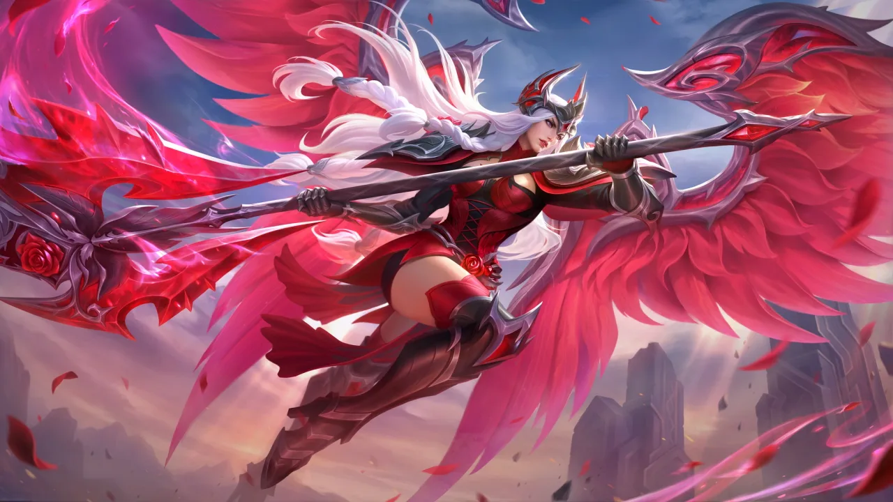

[Тир-лист](https://boostmlbb.ru/heroes/)[Предметы](https://boostmlbb.ru/items/)[Скины](https://boostmlbb.ru/skins/)[Новости и гайды](https://boostmlbb.ru/news/)

[Скины](https://boostmlbb.ru/skins/)/[Фрейя](https://boostmlbb.ru/skins/freya.html)/Тёмная роза

[Скин Фрейи](https://boostmlbb.ru/skins/freya.html)

# Тёмная роза

Dark Rose

Обычный CommonВ продаже

Как получить

Продаётся в магазине обликов за 269 алмазов.

Цена

269 алмазов

Вышел

2017 год

## Что меняет облик

-   Бонус к характеристикам

## Все скины Фрейи [9](https://boostmlbb.ru/skins/freya.html)

[Галакти­ческая победи­тельницаВысший · 2024](https://boostmlbb.ru/skins/freya/galactic-vanquisher.html)[Ловчая S.A.B.E.R.Делюкс · 2022](https://boostmlbb.ru/skins/freya/s-a-b-e-r-manhunter.html)[Сёгун-воронДелюкс · 2020](https://boostmlbb.ru/skins/freya/raven-shogun.html)[Рож­дественский карнавалИсключительный · 2018](https://boostmlbb.ru/skins/freya/christmas-carnival.html)[ГладиаторОбычный · 2018](https://boostmlbb.ru/skins/freya/gladiator.html)[Охотница на драконовИсключительный · 2017](https://boostmlbb.ru/skins/freya/dragon-hunter.html)[Ангел войныИзысканный · 2017](https://boostmlbb.ru/skins/freya/war-angel.html)[Пляжная красоткаИсключительный · 2017](https://boostmlbb.ru/skins/freya/beach-sweetheart.html)[Тёмная розаОбычный · 2017](https://boostmlbb.ru/skins/freya/dark-rose.html)

**Поднимем ранг на герое Фрейя**Цена считается в калькуляторе

[Рассчитать цену](https://boostmlbb.ru/order.html?type=hero)

## Частые вопросы

Как получить скин «Тёмная роза» на Фрейю?

Продаётся в магазине обликов за 269 алмазов.

Когда вышел скин «Тёмная роза»?

2017 год.

Какой класс у скина «Тёмная роза»?

Обычный (Common).
