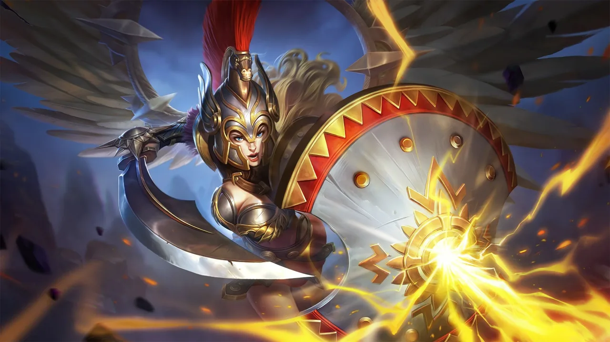

[Скины Фрейи](https://boostmlbb.ru/skins/freya.html)

[Скины](https://boostmlbb.ru/skins/)/[Фрейя](https://boostmlbb.ru/skins/freya.html)/Гладиатор

[Скин Фрейи](https://boostmlbb.ru/skins/freya.html)

# Гладиатор

Gladiator

Обычный CommonЭлитныйВ продаже

Как получить

Продаётся в магазине обликов за 599 алмазов.

Цена

599 алмазов

Вышел

2018 год

## Что меняет облик

-   Новая внешность
-   Другой цвет эффектов
-   Анимация показа
-   Бонус к характеристикам

## Перекраски

Тот же облик в других цветах. Перекраска открывается, только если у вас уже есть сам облик.

-   **Дух Спарты** Spartan SpiritНаграда «Звёздного участника» в мае 2020.

## Все скины Фрейи [9](https://boostmlbb.ru/skins/freya.html)

[Галакти­ческая победи­тельницаВысший · 2024](https://boostmlbb.ru/skins/freya/galactic-vanquisher.html)[Ловчая S.A.B.E.R.Делюкс · 2022](https://boostmlbb.ru/skins/freya/s-a-b-e-r-manhunter.html)[Сёгун-воронДелюкс · 2020](https://boostmlbb.ru/skins/freya/raven-shogun.html)[Рож­дественский карнавалИсключительный · 2018](https://boostmlbb.ru/skins/freya/christmas-carnival.html)[ГладиаторОбычный · 2018](https://boostmlbb.ru/skins/freya/gladiator.html)[Охотница на драконовИсключительный · 2017](https://boostmlbb.ru/skins/freya/dragon-hunter.html)[Ангел войныИзысканный · 2017](https://boostmlbb.ru/skins/freya/war-angel.html)[Пляжная красоткаИсключительный · 2017](https://boostmlbb.ru/skins/freya/beach-sweetheart.html)[Тёмная розаОбычный · 2017](https://boostmlbb.ru/skins/freya/dark-rose.html)

## Серия «Элитный»

[Золотой османтусЧан'Э · 2026](https://boostmlbb.ru/skins/change/golden-osmanthus.html)[Король-воена­чальникМартис · 2025](https://boostmlbb.ru/skins/martis/warlord-king.html)[Кадет открытого моряКимми · 2024](https://boostmlbb.ru/skins/kimmy/high-seas-cadet.html)[Зелёная копейщицаСильвана · 2024](https://boostmlbb.ru/skins/silvanna/verdant-lancer.html)[Мародёр Кровавое КопытоХилос · 2024](https://boostmlbb.ru/skins/hylos/bloodhoof-marauder.html)[Изящная бабочкаГвиневра · 2024](https://boostmlbb.ru/skins/guinevere/elegant-butterfly.html)[Маркиз клинковЛанселот · 2024](https://boostmlbb.ru/skins/lancelot/marques-of-blades.html)[Привал в пустошахЧип · 2024](https://boostmlbb.ru/skins/chip/badlands-hiatus.html)

**Сколько стоит буст на герое Фрейя?**Выберите текущий и желаемый ранг. Стоимость появится на сайте.

[Рассчитать цену](https://boostmlbb.ru/order.html?type=hero)

## Частые вопросы

Как получить скин «Гладиатор» на Фрейю?

Продаётся в магазине обликов за 599 алмазов.

Когда вышел скин «Гладиатор»?

2018 год.

Какой класс у скина «Гладиатор»?

Обычный (Common), серия «Элитный».
