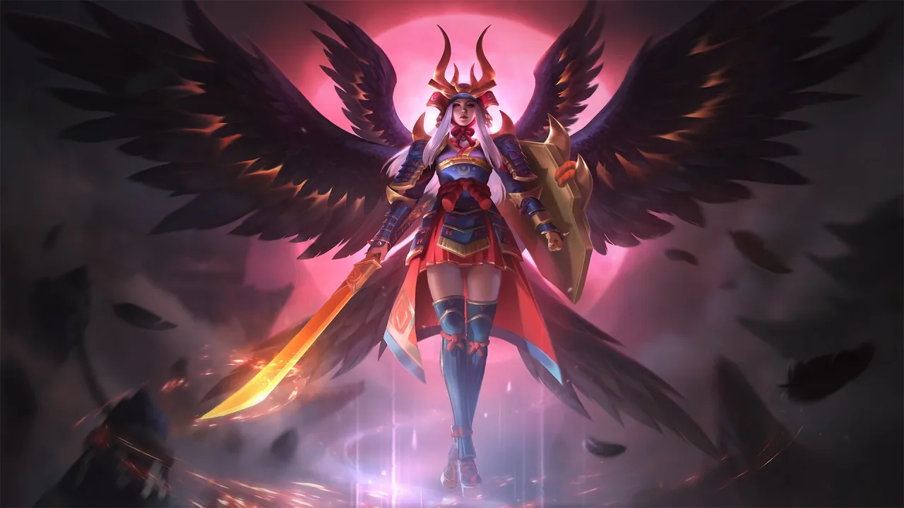

[Скины Фрейи](https://boostmlbb.ru/skins/freya.html)

[Скины](https://boostmlbb.ru/skins/)/[Фрейя](https://boostmlbb.ru/skins/freya.html)/Сёгун-ворон

[Скин Фрейи](https://boostmlbb.ru/skins/freya.html)

# Сёгун-ворон

Raven Shogun

Делюкс DeluxeЭпическийВ продаже

Как получить

Продаётся в магазине обликов за 899 алмазов.

Цена

899 алмазов

Вышел

2020 год

## Что меняет облик

-   Новая внешность
-   Новые эффекты навыков
-   Анимация показа
-   Сцена показа
-   Бонус к характеристикам

## Все скины Фрейи [9](https://boostmlbb.ru/skins/freya.html)

[Галакти­ческая победи­тельницаВысший · 2024](https://boostmlbb.ru/skins/freya/galactic-vanquisher.html)[Ловчая S.A.B.E.R.Делюкс · 2022](https://boostmlbb.ru/skins/freya/s-a-b-e-r-manhunter.html)[Сёгун-воронДелюкс · 2020](https://boostmlbb.ru/skins/freya/raven-shogun.html)[Рож­дественский карнавалИсключительный · 2018](https://boostmlbb.ru/skins/freya/christmas-carnival.html)[ГладиаторОбычный · 2018](https://boostmlbb.ru/skins/freya/gladiator.html)[Охотница на драконовИсключительный · 2017](https://boostmlbb.ru/skins/freya/dragon-hunter.html)[Ангел войныИзысканный · 2017](https://boostmlbb.ru/skins/freya/war-angel.html)[Пляжная красоткаИсключительный · 2017](https://boostmlbb.ru/skins/freya/beach-sweetheart.html)[Тёмная розаОбычный · 2017](https://boostmlbb.ru/skins/freya/dark-rose.html)

## Серия «Эпический»

[Надзи­ратель преис­поднейМинотавр · 2026](https://boostmlbb.ru/skins/minotaur/nether-overseer.html)[Затонувшее проклятиеАтлас · 2026](https://boostmlbb.ru/skins/atlas/sunken-curse.html)[Вечная клятваВексана · 2026](https://boostmlbb.ru/skins/vexana/eternal-vow.html)[Проклятый свитокХуфра · 2025](https://boostmlbb.ru/skins/khufra/cursed-scroll.html)[Охотница за душамиНаталья · 2025](https://boostmlbb.ru/skins/natalia/soul-huntress.html)[Граф кошмаровЛеоморд · 2025](https://boostmlbb.ru/skins/leomord/nightmare-count.html)[Вершитель звёздБелерик · 2025](https://boostmlbb.ru/skins/belerick/arbiter-of-stars.html)[Хранитель ветровВэйл · 2025](https://boostmlbb.ru/skins/vale/keeper-of-the-winds.html)

**Сколько стоит буст на герое Фрейя?**Выберите текущий и желаемый ранг. Стоимость появится на сайте.

[Рассчитать цену](https://boostmlbb.ru/order.html?type=hero)

## Частые вопросы

Как получить скин «Сёгун-ворон» на Фрейю?

Продаётся в магазине обликов за 899 алмазов.

Когда вышел скин «Сёгун-ворон»?

2020 год.

Какой класс у скина «Сёгун-ворон»?

Делюкс (Deluxe), серия «Эпический».
