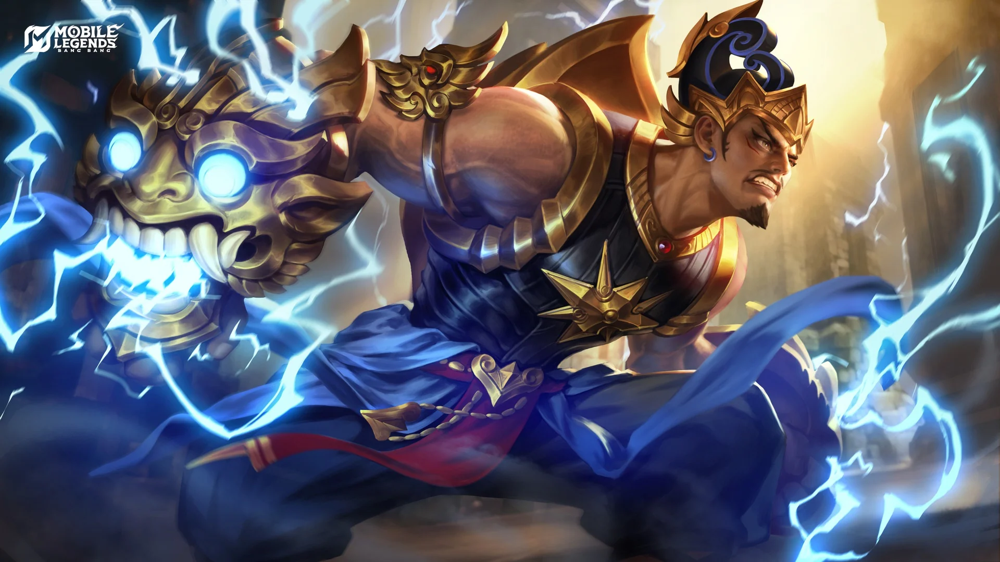
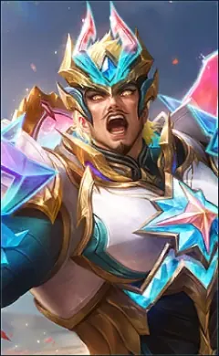

[Тир-лист](https://boostmlbb.ru/heroes/)[Предметы](https://boostmlbb.ru/items/)[Скины](https://boostmlbb.ru/skins/)[Новости и гайды](https://boostmlbb.ru/news/)

[Скины](https://boostmlbb.ru/skins/)/Гатоткача

# Скины Гатоткачи

Скинов

7

Можно купить

2

Последний

[Щелкунчик-монарх](https://boostmlbb.ru/skins/gatotkaca/nutcracker-monarch.html)2024

[Профиль героя→](https://boostmlbb.ru/heroes/gatotkaca.html)

## Все скины

ВсеИзысканныйДелюксИсключительныйОбычный

[Щелкунчик-монархИсключительный · 2024](https://boostmlbb.ru/skins/gatotkaca/nutcracker-monarch.html)[Хранитель приливовДелюкс · 2024](https://boostmlbb.ru/skins/gatotkaca/tide-preserver.html)[ИскраОбычный · 2019](https://boostmlbb.ru/skins/gatotkaca/spark.html)[ЧасовойИзысканный · 2018](https://boostmlbb.ru/skins/gatotkaca/sentinel.html)[Король архатовОбычный · 2018](https://boostmlbb.ru/skins/gatotkaca/arhat-king.html)[Могучий стражОбычный · 2017](https://boostmlbb.ru/skins/gatotkaca/mighty-guardian.html)[Солнечная искра](https://boostmlbb.ru/skins/gatotkaca/solar-spark.html)

**Поднимем ранг на герое Гатоткача**Цена считается в калькуляторе

[Рассчитать цену](https://boostmlbb.ru/order.html?type=hero)

## Частые вопросы

Сколько скинов у Гатоткачи?

7 скинов без стандартного облика. Последний — «Щелкунчик-монарх» (Nutcracker Monarch), 1 августа 2024.

Какие скины Гатоткачи можно купить сейчас?

«Хранитель приливов» (899 алмазов), «Могучий страж» (269 алмазов). Остальные облики ограниченные и возвращаются только в событиях.

Какой самый редкий скин Гатоткачи?

«Часовой» (Sentinel), класс изысканный, серия «Ящик удачи». Выпадал из ящиков удачи в событиях. Ограниченные облики иногда возвращаются в розыгрышах событий.
