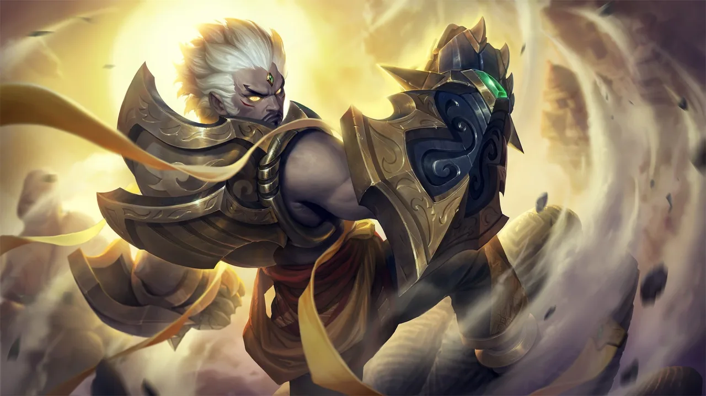

[Тир-лист](https://boostmlbb.ru/heroes/)[Предметы](https://boostmlbb.ru/items/)[Скины](https://boostmlbb.ru/skins/)[Новости и гайды](https://boostmlbb.ru/news/)

[Скины](https://boostmlbb.ru/skins/)/[Гатоткача](https://boostmlbb.ru/skins/gatotkaca.html)/Король архатов

[Скин Гатоткачи](https://boostmlbb.ru/skins/gatotkaca.html)

# Король архатов

Arhat King

Обычный CommonЭлитныйОграниченный

Как получить

Выходил в магазине обликов во время события. Ограниченные облики иногда возвращаются в розыгрышах событий.

Вышел

7 октября 2018

## Что меняет облик

-   Новая внешность
-   Другой цвет эффектов
-   Анимация показа
-   Бонус к характеристикам

## Перекраски

Тот же облик в других цветах. Перекраска открывается, только если у вас уже есть сам облик.

-   **Сталевар** Steeler188 алмазов

## Все скины Гатоткачи [7](https://boostmlbb.ru/skins/gatotkaca.html)

[Щелкунчик-монархИсключительный · 2024](https://boostmlbb.ru/skins/gatotkaca/nutcracker-monarch.html)[Хранитель приливовДелюкс · 2024](https://boostmlbb.ru/skins/gatotkaca/tide-preserver.html)[ИскраОбычный · 2019](https://boostmlbb.ru/skins/gatotkaca/spark.html)[ЧасовойИзысканный · 2018](https://boostmlbb.ru/skins/gatotkaca/sentinel.html)[Король архатовОбычный · 2018](https://boostmlbb.ru/skins/gatotkaca/arhat-king.html)[Могучий стражОбычный · 2017](https://boostmlbb.ru/skins/gatotkaca/mighty-guardian.html)[Солнечная искра](https://boostmlbb.ru/skins/gatotkaca/solar-spark.html)

## Серия «Элитный»

[Золотой османтусЧан'Э · 2026](https://boostmlbb.ru/skins/change/golden-osmanthus.html)[Король-воена­чальникМартис · 2025](https://boostmlbb.ru/skins/martis/warlord-king.html)[Кадет открытого моряКимми · 2024](https://boostmlbb.ru/skins/kimmy/high-seas-cadet.html)[Зелёная копейщицаСильвана · 2024](https://boostmlbb.ru/skins/silvanna/verdant-lancer.html)[Мародёр Кровавое КопытоХилос · 2024](https://boostmlbb.ru/skins/hylos/bloodhoof-marauder.html)[Изящная бабочкаГвиневра · 2024](https://boostmlbb.ru/skins/guinevere/elegant-butterfly.html)[Маркиз клинковЛанселот · 2024](https://boostmlbb.ru/skins/lancelot/marques-of-blades.html)[Привал в пустошахЧип · 2024](https://boostmlbb.ru/skins/chip/badlands-hiatus.html)

**Поднимем ранг на герое Гатоткача**Цена считается в калькуляторе

[Рассчитать цену](https://boostmlbb.ru/order.html?type=hero)

## Частые вопросы

Как получить скин «Король архатов» на Гатоткачу?

Выходил в магазине обликов во время события. Ограниченные облики иногда возвращаются в розыгрышах событий.

Когда вышел скин «Король архатов»?

7 октября 2018.

Какой класс у скина «Король архатов»?

Обычный (Common), серия «Элитный».
