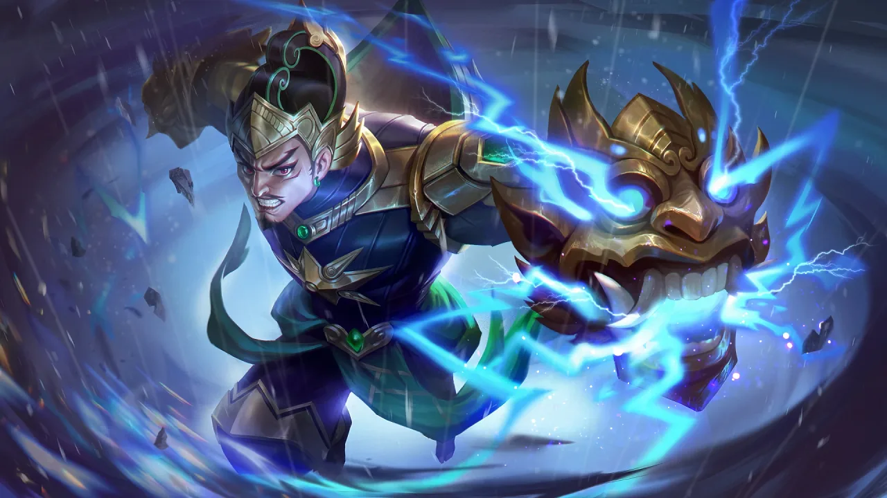

[Скины Гатоткачи](https://boostmlbb.ru/skins/gatotkaca.html)

[Скины](https://boostmlbb.ru/skins/)/[Гатоткача](https://boostmlbb.ru/skins/gatotkaca.html)/Могучий страж

[Скин Гатоткачи](https://boostmlbb.ru/skins/gatotkaca.html)

# Могучий страж

Mighty Guardian

Обычный CommonВ продаже

Как получить

Продаётся в магазине обликов за 269 алмазов.

Цена

269 алмазов

Вышел

11 августа 2017

## Что меняет облик

-   Бонус к характеристикам

## Все скины Гатоткачи [7](https://boostmlbb.ru/skins/gatotkaca.html)

[Щелкунчик-монархИсключительный · 2024](https://boostmlbb.ru/skins/gatotkaca/nutcracker-monarch.html)[Хранитель приливовДелюкс · 2024](https://boostmlbb.ru/skins/gatotkaca/tide-preserver.html)[ИскраОбычный · 2019](https://boostmlbb.ru/skins/gatotkaca/spark.html)[ЧасовойИзысканный · 2018](https://boostmlbb.ru/skins/gatotkaca/sentinel.html)[Король архатовОбычный · 2018](https://boostmlbb.ru/skins/gatotkaca/arhat-king.html)[Могучий стражОбычный · 2017](https://boostmlbb.ru/skins/gatotkaca/mighty-guardian.html)[Солнечная искра](https://boostmlbb.ru/skins/gatotkaca/solar-spark.html)

**Сколько стоит буст на герое Гатоткача?**Выберите текущий и желаемый ранг. Стоимость появится на сайте.

[Рассчитать цену](https://boostmlbb.ru/order.html?type=hero)

## Частые вопросы

Как получить скин «Могучий страж» на Гатоткачу?

Продаётся в магазине обликов за 269 алмазов.

Когда вышел скин «Могучий страж»?

11 августа 2017.

Какой класс у скина «Могучий страж»?

Обычный (Common).
