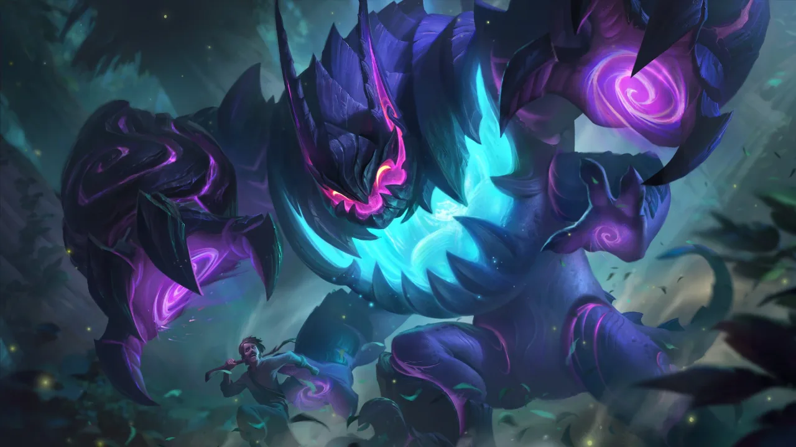

[Все скины](https://boostmlbb.ru/skins/)

[Скины](https://boostmlbb.ru/skins/)/Глу

# Скины Глу

Скинов

4

Можно купить

2

Последний

[Патрик](https://boostmlbb.ru/skins/gloo/patrick.html)2025

[Профиль героя→](https://boostmlbb.ru/heroes/gloo.html)

## Все скины

[ПатрикДелюкс · 2025](https://boostmlbb.ru/skins/gloo/patrick.html)[Желейный человекИсключительный · 2023](https://boostmlbb.ru/skins/gloo/jellyman.html)[Зелёный чародейОбычный · 2021](https://boostmlbb.ru/skins/gloo/verdant-enchanter.html)[Снежный Глу](https://boostmlbb.ru/skins/gloo/abominable-snowgloo.html)

**Сколько стоит буст на герое Глу?**Выберите текущий и желаемый ранг. Стоимость появится на сайте.

[Рассчитать цену](https://boostmlbb.ru/order.html?type=hero)

## Частые вопросы

Сколько скинов у Глу?

4 скина без стандартного облика. Последний — «Патрик» (Patrick), 21 декабря 2025.

Какие скины Глу можно купить сейчас?

«Желейный человек» (749 алмазов), «Зелёный чародей» (269 алмазов). Остальные облики ограниченные и возвращаются только в событиях.

Какой самый редкий скин Глу?

«Патрик» (Patrick), класс делюкс, серия «Губка Боб». Выходил в событии коллаборации MLBB × Губка Боб. Ограниченные облики иногда возвращаются в розыгрышах событий.
