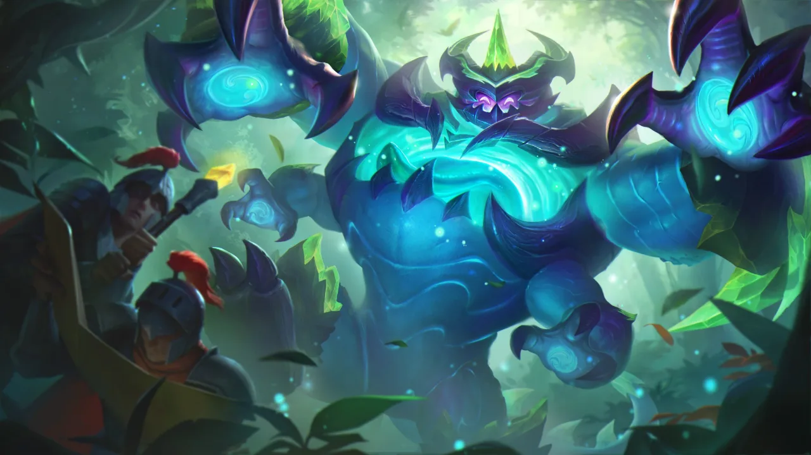

[Скины Глу](https://boostmlbb.ru/skins/gloo.html)

[Скины](https://boostmlbb.ru/skins/)/[Глу](https://boostmlbb.ru/skins/gloo.html)/Зелёный чародей

[Скин Глу](https://boostmlbb.ru/skins/gloo.html)

# Зелёный чародей

Verdant Enchanter

Обычный CommonВ продаже

Как получить

Продаётся в магазине обликов за 269 алмазов.

Цена

269 алмазов

Вышел

16 апреля 2021

## Что меняет облик

-   Бонус к характеристикам

## Все скины Глу [4](https://boostmlbb.ru/skins/gloo.html)

[ПатрикДелюкс · 2025](https://boostmlbb.ru/skins/gloo/patrick.html)[Желейный человекИсключительный · 2023](https://boostmlbb.ru/skins/gloo/jellyman.html)[Зелёный чародейОбычный · 2021](https://boostmlbb.ru/skins/gloo/verdant-enchanter.html)[Снежный Глу](https://boostmlbb.ru/skins/gloo/abominable-snowgloo.html)

**Сколько стоит буст на герое Глу?**Выберите текущий и желаемый ранг. Стоимость появится на сайте.

[Рассчитать цену](https://boostmlbb.ru/order.html?type=hero)

## Частые вопросы

Как получить скин «Зелёный чародей» на Глу?

Продаётся в магазине обликов за 269 алмазов.

Когда вышел скин «Зелёный чародей»?

16 апреля 2021.

Какой класс у скина «Зелёный чародей»?

Обычный (Common).
