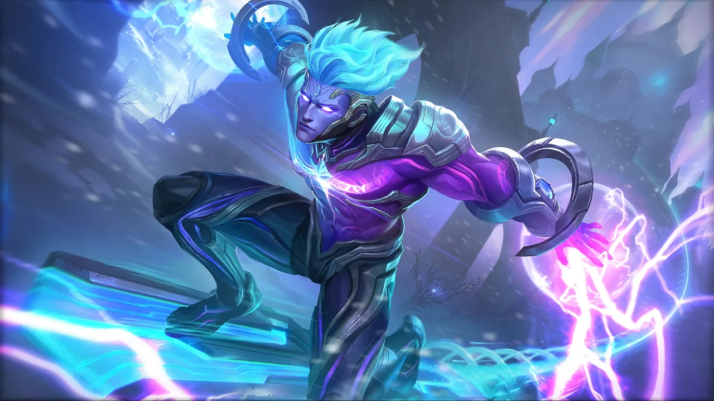

[Все скины](https://boostmlbb.ru/skins/)

[Скины](https://boostmlbb.ru/skins/)/Горд

# Скины Горда

Скинов

7

Можно купить

3

Последний

[Император Виталис](https://boostmlbb.ru/skins/gord/imperator-vitalis.html)2025

[Профиль героя→](https://boostmlbb.ru/heroes/gord.html)

## Все скины

ВсеВысшийИзысканныйДелюксИсключительныйОбычный

[Император ВиталисИсключительный · 2025](https://boostmlbb.ru/skins/gord/imperator-vitalis.html)[Кибер-хакерДелюкс · 2024](https://boostmlbb.ru/skins/gord/cyber-hacker.html)[Новый баронОбычный · 2021](https://boostmlbb.ru/skins/gord/new-baron.html)[Контролёр №1Изысканный · 2019](https://boostmlbb.ru/skins/gord/no-1-controller.html)[Завое­вательВысший · 2018](https://boostmlbb.ru/skins/gord/conqueror.html)[Рож­дественский карнавалИсключительный · 2016](https://boostmlbb.ru/skins/gord/christmas-carnival.html)[Профессор адаОбычный · 2016](https://boostmlbb.ru/skins/gord/professor-of-hell.html)

**Сколько стоит буст на герое Горд?**Выберите текущий и желаемый ранг. Стоимость появится на сайте.

[Рассчитать цену](https://boostmlbb.ru/order.html?type=hero)

## Частые вопросы

Сколько скинов у Горда?

7 скинов без стандартного облика. Последний — «Император Виталис» (Imperator Vitalis), 1 июня 2025.

Какие скины Горда можно купить сейчас?

«Кибер-хакер» (899 алмазов), «Профессор ада» (269 алмазов). Остальные облики ограниченные и возвращаются только в событиях.

Какой самый редкий скин Горда?

«Завоеватель» (Conqueror), класс высший, серия «Легендарный». Обменивается на 200 магических кристаллов из Магического колеса.
