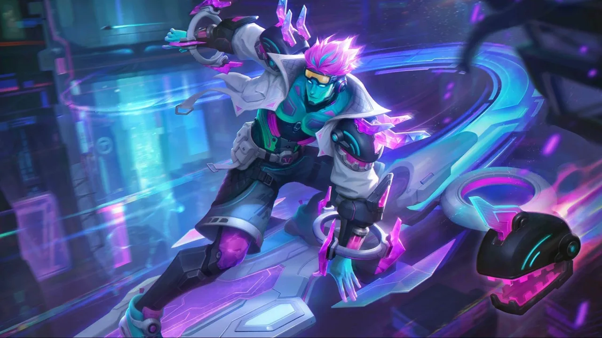

[Скины Горда](https://boostmlbb.ru/skins/gord.html)

[Скины](https://boostmlbb.ru/skins/)/[Горд](https://boostmlbb.ru/skins/gord.html)/Кибер-хакер

[Скин Горда](https://boostmlbb.ru/skins/gord.html)

# Кибер-хакер

Cyber Hacker

Делюкс DeluxeЭпическийВ продаже

Как получить

Продаётся в магазине обликов за 899 алмазов.

Цена

899 алмазов

Вышел

21 августа 2024

## Что меняет облик

-   Новая внешность
-   Новые эффекты навыков
-   Звуки навыков
-   Анимация показа
-   Сцена показа
-   Музыка показа
-   Бонус к характеристикам

## Все скины Горда [7](https://boostmlbb.ru/skins/gord.html)

[Император ВиталисИсключительный · 2025](https://boostmlbb.ru/skins/gord/imperator-vitalis.html)[Кибер-хакерДелюкс · 2024](https://boostmlbb.ru/skins/gord/cyber-hacker.html)[Новый баронОбычный · 2021](https://boostmlbb.ru/skins/gord/new-baron.html)[Контролёр №1Изысканный · 2019](https://boostmlbb.ru/skins/gord/no-1-controller.html)[Завое­вательВысший · 2018](https://boostmlbb.ru/skins/gord/conqueror.html)[Рож­дественский карнавалИсключительный · 2016](https://boostmlbb.ru/skins/gord/christmas-carnival.html)[Профессор адаОбычный · 2016](https://boostmlbb.ru/skins/gord/professor-of-hell.html)

## Серия «Эпический»

[Надзи­ратель преис­поднейМинотавр · 2026](https://boostmlbb.ru/skins/minotaur/nether-overseer.html)[Затонувшее проклятиеАтлас · 2026](https://boostmlbb.ru/skins/atlas/sunken-curse.html)[Вечная клятваВексана · 2026](https://boostmlbb.ru/skins/vexana/eternal-vow.html)[Проклятый свитокХуфра · 2025](https://boostmlbb.ru/skins/khufra/cursed-scroll.html)[Охотница за душамиНаталья · 2025](https://boostmlbb.ru/skins/natalia/soul-huntress.html)[Граф кошмаровЛеоморд · 2025](https://boostmlbb.ru/skins/leomord/nightmare-count.html)[Вершитель звёздБелерик · 2025](https://boostmlbb.ru/skins/belerick/arbiter-of-stars.html)[Хранитель ветровВэйл · 2025](https://boostmlbb.ru/skins/vale/keeper-of-the-winds.html)

**Сколько стоит буст на герое Горд?**Выберите текущий и желаемый ранг. Стоимость появится на сайте.

[Рассчитать цену](https://boostmlbb.ru/order.html?type=hero)

## Частые вопросы

Как получить скин «Кибер-хакер» на Горда?

Продаётся в магазине обликов за 899 алмазов.

Когда вышел скин «Кибер-хакер»?

21 августа 2024.

Какой класс у скина «Кибер-хакер»?

Делюкс (Deluxe), серия «Эпический».
