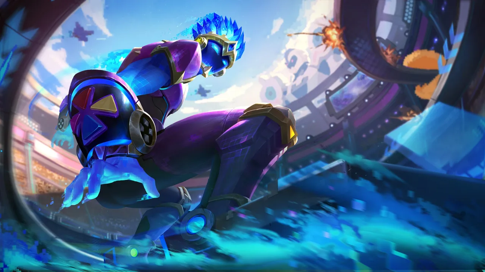

[Тир-лист](https://boostmlbb.ru/heroes/)[Предметы](https://boostmlbb.ru/items/)[Скины](https://boostmlbb.ru/skins/)[Новости и гайды](https://boostmlbb.ru/news/)

[Скины](https://boostmlbb.ru/skins/)/[Горд](https://boostmlbb.ru/skins/gord.html)/Контролёр №1

[Скин Горда](https://boostmlbb.ru/skins/gord.html)

# Контролёр №1

No.1 Controller

Изысканный ExquisiteЕжегодный звёздный участникОграниченный

Как получить

Событие StarLight Fest 2019.

Вышел

2019 год

## Что меняет облик

-   Новая внешность
-   Новые эффекты навыков
-   Звуки навыков
-   Своя озвучка
-   Анимация показа
-   Сцена показа
-   Бонус к характеристикам

## Все скины Горда [7](https://boostmlbb.ru/skins/gord.html)

[Император ВиталисИсключительный · 2025](https://boostmlbb.ru/skins/gord/imperator-vitalis.html)[Кибер-хакерДелюкс · 2024](https://boostmlbb.ru/skins/gord/cyber-hacker.html)[Новый баронОбычный · 2021](https://boostmlbb.ru/skins/gord/new-baron.html)[Контролёр №1Изысканный · 2019](https://boostmlbb.ru/skins/gord/no-1-controller.html)[Завое­вательВысший · 2018](https://boostmlbb.ru/skins/gord/conqueror.html)[Рож­дественский карнавалИсключительный · 2016](https://boostmlbb.ru/skins/gord/christmas-carnival.html)[Профессор адаОбычный · 2016](https://boostmlbb.ru/skins/gord/professor-of-hell.html)

## Серия «Ежегодный звёздный участник»

[Концерт светаВэйл · 2024](https://boostmlbb.ru/skins/vale/concerto-of-light.html)[Аватар времениАнгела · 2023](https://boostmlbb.ru/skins/angela/avatar-of-time.html)[Зоркий снайперЛесли · 2021](https://boostmlbb.ru/skins/lesley/hawk-eyed-sniper.html)[КувшинкаКагура · 2021](https://boostmlbb.ru/skins/kagura/water-lily.html)[Неоновое колесоКэрри · 2020](https://boostmlbb.ru/skins/karrie/neon-lightwheel.html)[Экспе­римент 21Хаябуса · 2018](https://boostmlbb.ru/skins/hayabusa/experiment-21.html)

**Поднимем ранг на герое Горд**Цена считается в калькуляторе

[Рассчитать цену](https://boostmlbb.ru/order.html?type=hero)

## Частые вопросы

Как получить скин «Контролёр №1» на Горда?

Событие StarLight Fest 2019.

Когда вышел скин «Контролёр №1»?

2019 год.

Какой класс у скина «Контролёр №1»?

Изысканный (Exquisite), серия «Ежегодный звёздный участник».
