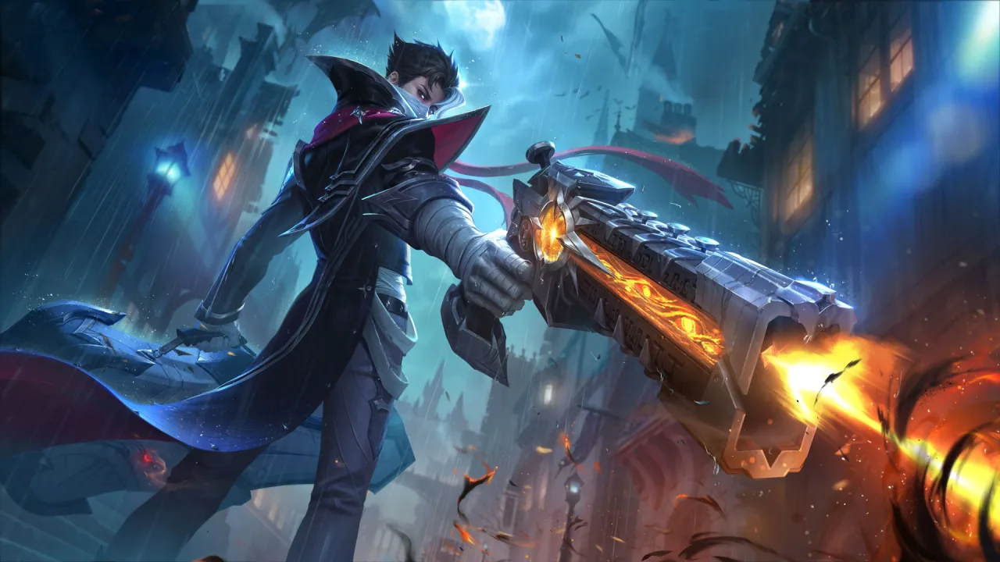

[Тир-лист](https://boostmlbb.ru/heroes/)[Предметы](https://boostmlbb.ru/items/)[Скины](https://boostmlbb.ru/skins/)[Новости и гайды](https://boostmlbb.ru/news/)

[Скины](https://boostmlbb.ru/skins/)/Грейнджер

# Скины Грейнджера

Скинов

12

Можно купить

4

Последний

[Рождённый светом: Подавитель](https://boostmlbb.ru/skins/granger/lightborn-overrider.html)2024

[Профиль героя→](https://boostmlbb.ru/heroes/granger.html)

## Все скины

ВсеВысшийГрандиозныйИзысканныйДелюксИсключительныйОбычный

[Рождённый светом: ПодавительДелюкс · 2024](https://boostmlbb.ru/skins/granger/lightborn-overrider.html)[Манящая загадкаДелюкс · 2024](https://boostmlbb.ru/skins/granger/alluring-enigma.html)[Экзорцист ГрейнджерГрандиозный · 2023](https://boostmlbb.ru/skins/granger/exorcist-granger.html)[Вестник адаИсключительный · 2023](https://boostmlbb.ru/skins/granger/hellbringer.html)[МегатронГрандиозный · 2023](https://boostmlbb.ru/skins/granger/megatron.html)[Рыцарь звездопадаВысший · 2021](https://boostmlbb.ru/skins/granger/starfall-knight.html)[Агент ZИзысканный · 2020](https://boostmlbb.ru/skins/granger/agent-z.html)[БиосолдатИсключительный · 2020](https://boostmlbb.ru/skins/granger/biosoldier.html)[Терминатор судного дняОбычный · 2019](https://boostmlbb.ru/skins/granger/doomsday-terminator.html)[Шёпот бардаОбычный · 2019](https://boostmlbb.ru/skins/granger/bardic-whisper.html)[Косми­ческий финал](https://boostmlbb.ru/skins/granger/cosmic-finality.html)[Восходящий гром](https://boostmlbb.ru/skins/granger/thunder-ascendant.html)

**Поднимем ранг на герое Грейнджер**Цена считается в калькуляторе

[Рассчитать цену](https://boostmlbb.ru/order.html?type=hero)

## Частые вопросы

Сколько скинов у Грейнджера?

12 скинов без стандартного облика. Последний — «Рождённый светом: Подавитель» (Lightborn - Overrider), 16 марта 2024.

Какие скины Грейнджера можно купить сейчас?

«Рождённый светом: Подавитель» (1 080 алмазов), «Вестник ада» (749 алмазов), «Терминатор судного дня» (599 алмазов), «Шёпот барда» (269 алмазов). Остальные облики ограниченные и возвращаются только в событиях.

Какой самый редкий скин Грейнджера?

«Рыцарь звездопада» (Starfall Knight), класс высший, серия «Легендарный». Обменивается на магические кристаллы из Магического колеса. Ограниченные облики иногда возвращаются в розыгрышах событий.
