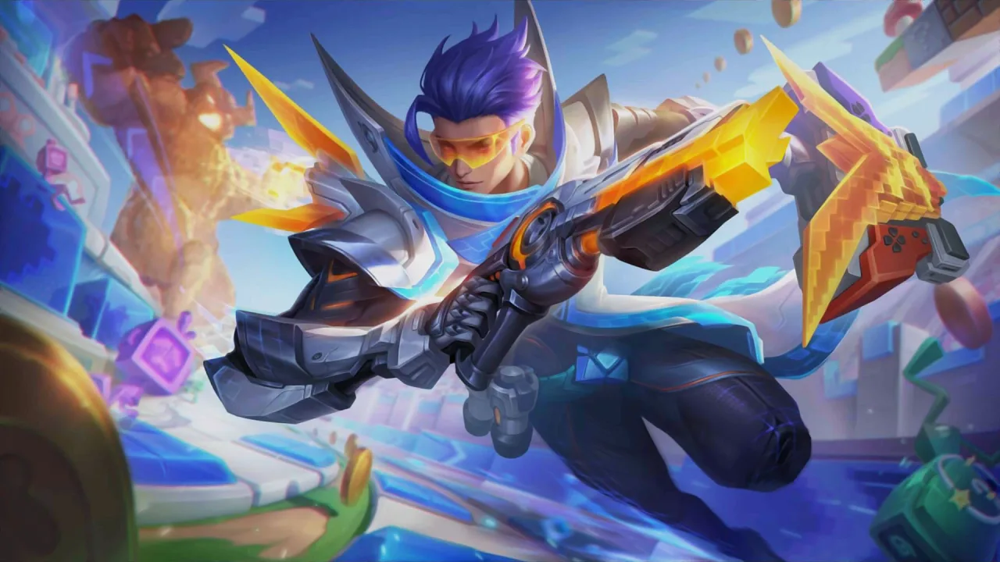

[Тир-лист](https://boostmlbb.ru/heroes/)[Предметы](https://boostmlbb.ru/items/)[Скины](https://boostmlbb.ru/skins/)[Новости и гайды](https://boostmlbb.ru/news/)

[Скины](https://boostmlbb.ru/skins/)/[Грейнджер](https://boostmlbb.ru/skins/granger.html)/Агент Z

[Скин Грейнджера](https://boostmlbb.ru/skins/granger.html)

# Агент Z

Agent Z

Изысканный ExquisiteКоллекционныйОграниченный

Как получить

Главный приз розыгрыша в коллекционном событии, попытки покупаются за алмазы. Ограниченные облики иногда возвращаются в розыгрышах событий.

Вышел

5 октября 2020

## Что меняет облик

-   Новая внешность
-   Новые эффекты навыков
-   Звуки навыков
-   Анимация показа
-   Сцена показа
-   Бонус к характеристикам

## Все скины Грейнджера [12](https://boostmlbb.ru/skins/granger.html)

[Рождённый светом: ПодавительДелюкс · 2024](https://boostmlbb.ru/skins/granger/lightborn-overrider.html)[Манящая загадкаДелюкс · 2024](https://boostmlbb.ru/skins/granger/alluring-enigma.html)[Экзорцист ГрейнджерГрандиозный · 2023](https://boostmlbb.ru/skins/granger/exorcist-granger.html)[Вестник адаИсключительный · 2023](https://boostmlbb.ru/skins/granger/hellbringer.html)[МегатронГрандиозный · 2023](https://boostmlbb.ru/skins/granger/megatron.html)[Рыцарь звездопадаВысший · 2021](https://boostmlbb.ru/skins/granger/starfall-knight.html)[Агент ZИзысканный · 2020](https://boostmlbb.ru/skins/granger/agent-z.html)[БиосолдатИсключительный · 2020](https://boostmlbb.ru/skins/granger/biosoldier.html)[Терминатор судного дняОбычный · 2019](https://boostmlbb.ru/skins/granger/doomsday-terminator.html)[Шёпот бардаОбычный · 2019](https://boostmlbb.ru/skins/granger/bardic-whisper.html)[Косми­ческий финал](https://boostmlbb.ru/skins/granger/cosmic-finality.html)[Восходящий гром](https://boostmlbb.ru/skins/granger/thunder-ascendant.html)

## Серия «Коллекционный»

[ОчистительБруно · 2026](https://boostmlbb.ru/skins/bruno/the-purifier.html)[Небесный бунтарьСан · 2026](https://boostmlbb.ru/skins/sun/celestial-rebel.html)[Кайдзю глубинХелкарт · 2026](https://boostmlbb.ru/skins/helcurt/kaiju-of-the-deep.html)[Звёздный дозорныйКимми · 2026](https://boostmlbb.ru/skins/kimmy/starbound-sentry.html)[Монархиня грёзАлиса · 2026](https://boostmlbb.ru/skins/alice/dreaming-monarch.html)[Дрожь глубинГрок · 2026](https://boostmlbb.ru/skins/grock/tremor-of-the-deep.html)[Небесный генералТигрил · 2026](https://boostmlbb.ru/skins/tigreal/celestial-general.html)[Монарх, рождённый солнцемКсавьер · 2026](https://boostmlbb.ru/skins/xavier/sunborn-monarch.html)

**Поднимем ранг на герое Грейнджер**Цена считается в калькуляторе

[Рассчитать цену](https://boostmlbb.ru/order.html?type=hero)

## Частые вопросы

Как получить скин «Агент Z» на Грейнджера?

Главный приз розыгрыша в коллекционном событии, попытки покупаются за алмазы. Ограниченные облики иногда возвращаются в розыгрышах событий.

Когда вышел скин «Агент Z»?

5 октября 2020.

Какой класс у скина «Агент Z»?

Изысканный (Exquisite), серия «Коллекционный».
