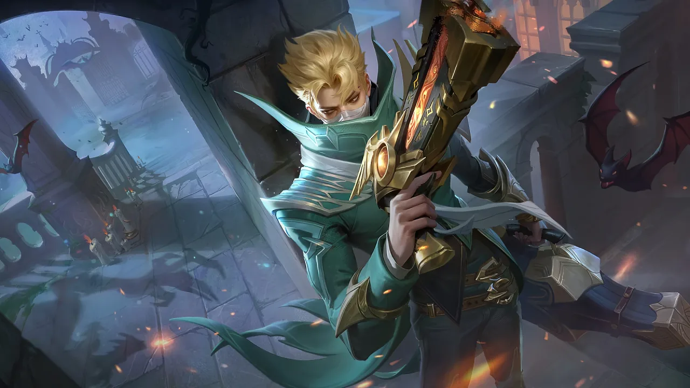
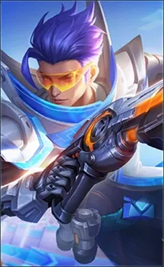

[Тир-лист](https://boostmlbb.ru/heroes/)[Предметы](https://boostmlbb.ru/items/)[Скины](https://boostmlbb.ru/skins/)[Новости и гайды](https://boostmlbb.ru/news/)

[Скины](https://boostmlbb.ru/skins/)/[Грейнджер](https://boostmlbb.ru/skins/granger.html)/Шёпот барда

[Скин Грейнджера](https://boostmlbb.ru/skins/granger.html)

# Шёпот барда

Bardic Whisper

Обычный CommonВ продаже

Как получить

Продаётся в магазине обликов за 269 алмазов.

Цена

269 алмазов

Вышел

23 апреля 2019

## Что меняет облик

-   Бонус к характеристикам

## Все скины Грейнджера [12](https://boostmlbb.ru/skins/granger.html)

[Рождённый светом: ПодавительДелюкс · 2024](https://boostmlbb.ru/skins/granger/lightborn-overrider.html)[Манящая загадкаДелюкс · 2024](https://boostmlbb.ru/skins/granger/alluring-enigma.html)[Экзорцист ГрейнджерГрандиозный · 2023](https://boostmlbb.ru/skins/granger/exorcist-granger.html)[Вестник адаИсключительный · 2023](https://boostmlbb.ru/skins/granger/hellbringer.html)[МегатронГрандиозный · 2023](https://boostmlbb.ru/skins/granger/megatron.html)[Рыцарь звездопадаВысший · 2021](https://boostmlbb.ru/skins/granger/starfall-knight.html)[Агент ZИзысканный · 2020](https://boostmlbb.ru/skins/granger/agent-z.html)[БиосолдатИсключительный · 2020](https://boostmlbb.ru/skins/granger/biosoldier.html)[Терминатор судного дняОбычный · 2019](https://boostmlbb.ru/skins/granger/doomsday-terminator.html)[Шёпот бардаОбычный · 2019](https://boostmlbb.ru/skins/granger/bardic-whisper.html)[Косми­ческий финал](https://boostmlbb.ru/skins/granger/cosmic-finality.html)[Восходящий гром](https://boostmlbb.ru/skins/granger/thunder-ascendant.html)

**Поднимем ранг на герое Грейнджер**Цена считается в калькуляторе

[Рассчитать цену](https://boostmlbb.ru/order.html?type=hero)

## Частые вопросы

Как получить скин «Шёпот барда» на Грейнджера?

Продаётся в магазине обликов за 269 алмазов.

Когда вышел скин «Шёпот барда»?

23 апреля 2019.

Какой класс у скина «Шёпот барда»?

Обычный (Common).
