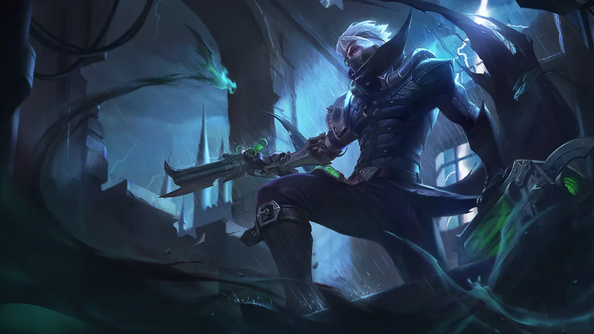

[Тир-лист](https://boostmlbb.ru/heroes/)[Предметы](https://boostmlbb.ru/items/)[Скины](https://boostmlbb.ru/skins/)[Новости и гайды](https://boostmlbb.ru/news/)

[Скины](https://boostmlbb.ru/skins/)/[Грейнджер](https://boostmlbb.ru/skins/granger.html)/Биосолдат

[Скин Грейнджера](https://boostmlbb.ru/skins/granger.html)

# Биосолдат

Biosoldier

Исключительный ExceptionalЗвёздный участникОграниченный

Как получить

Награда «Звёздного участника» в мае 2020.

Вышел

1 мая 2020

## Что меняет облик

-   Новая внешность
-   Новые эффекты навыков
-   Анимация показа
-   Бонус к характеристикам

## Все скины Грейнджера [12](https://boostmlbb.ru/skins/granger.html)

[Рождённый светом: ПодавительДелюкс · 2024](https://boostmlbb.ru/skins/granger/lightborn-overrider.html)[Манящая загадкаДелюкс · 2024](https://boostmlbb.ru/skins/granger/alluring-enigma.html)[Экзорцист ГрейнджерГрандиозный · 2023](https://boostmlbb.ru/skins/granger/exorcist-granger.html)[Вестник адаИсключительный · 2023](https://boostmlbb.ru/skins/granger/hellbringer.html)[МегатронГрандиозный · 2023](https://boostmlbb.ru/skins/granger/megatron.html)[Рыцарь звездопадаВысший · 2021](https://boostmlbb.ru/skins/granger/starfall-knight.html)[Агент ZИзысканный · 2020](https://boostmlbb.ru/skins/granger/agent-z.html)[БиосолдатИсключительный · 2020](https://boostmlbb.ru/skins/granger/biosoldier.html)[Терминатор судного дняОбычный · 2019](https://boostmlbb.ru/skins/granger/doomsday-terminator.html)[Шёпот бардаОбычный · 2019](https://boostmlbb.ru/skins/granger/bardic-whisper.html)[Косми­ческий финал](https://boostmlbb.ru/skins/granger/cosmic-finality.html)[Восходящий гром](https://boostmlbb.ru/skins/granger/thunder-ascendant.html)

## Серия «Звёздный участник»

[Морячка, рождённая приливомКалеа · 2026](https://boostmlbb.ru/skins/kalea/tideborn-sailor.html)[Тень кицунэХаябуса · 2026](https://boostmlbb.ru/skins/hayabusa/kitsune-s-shadow.html)[Клыки резниХанзо · 2026](https://boostmlbb.ru/skins/hanzo/fangs-of-slaughter.html)[Тлеющая крепостьБелерик · 2026](https://boostmlbb.ru/skins/belerick/smouldering-fortress.html)[Магитех­нический призракОбсидия · 2026](https://boostmlbb.ru/skins/obsidia/magitech-wraith.html)[Элизийское сияниеЦзэтянь · 2026](https://boostmlbb.ru/skins/zetian/elysian-luminance.html)[Батальон стражейХильда · 2026](https://boostmlbb.ru/skins/hilda/guardian-battalion.html)[Мечта­тельный коиХарли · 2026](https://boostmlbb.ru/skins/harley/dreaming-koi.html)

**Поднимем ранг на герое Грейнджер**Цена считается в калькуляторе

[Рассчитать цену](https://boostmlbb.ru/order.html?type=hero)

## Частые вопросы

Как получить скин «Биосолдат» на Грейнджера?

Награда «Звёздного участника» в мае 2020.

Когда вышел скин «Биосолдат»?

1 мая 2020.

Какой класс у скина «Биосолдат»?

Исключительный (Exceptional), серия «Звёздный участник».
