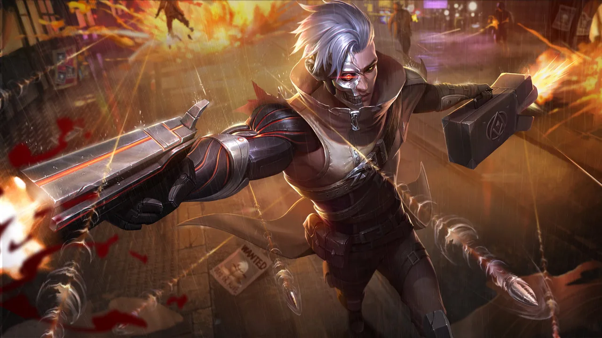

[Скины Грейнджера](https://boostmlbb.ru/skins/granger.html)

[Скины](https://boostmlbb.ru/skins/)/[Грейнджер](https://boostmlbb.ru/skins/granger.html)/Терминатор судного дня

[Скин Грейнджера](https://boostmlbb.ru/skins/granger.html)

# Терминатор судного дня

Doomsday Terminator

Обычный CommonЭлитныйВ продаже

Как получить

Продаётся в магазине обликов за 599 алмазов.

Цена

599 алмазов

Вышел

3 сентября 2019

## Что меняет облик

-   Новая внешность
-   Другой цвет эффектов
-   Анимация показа
-   Бонус к характеристикам

## Перекраски

Тот же облик в других цветах. Перекраска открывается, только если у вас уже есть сам облик.

-   **Каратель судного дня** Doomsday PunisherНаграда «Звёздного участника» в сентябре 2021.

## Все скины Грейнджера [12](https://boostmlbb.ru/skins/granger.html)

[Рождённый светом: ПодавительДелюкс · 2024](https://boostmlbb.ru/skins/granger/lightborn-overrider.html)[Манящая загадкаДелюкс · 2024](https://boostmlbb.ru/skins/granger/alluring-enigma.html)[Экзорцист ГрейнджерГрандиозный · 2023](https://boostmlbb.ru/skins/granger/exorcist-granger.html)[Вестник адаИсключительный · 2023](https://boostmlbb.ru/skins/granger/hellbringer.html)[МегатронГрандиозный · 2023](https://boostmlbb.ru/skins/granger/megatron.html)[Рыцарь звездопадаВысший · 2021](https://boostmlbb.ru/skins/granger/starfall-knight.html)[Агент ZИзысканный · 2020](https://boostmlbb.ru/skins/granger/agent-z.html)[БиосолдатИсключительный · 2020](https://boostmlbb.ru/skins/granger/biosoldier.html)[Терминатор судного дняОбычный · 2019](https://boostmlbb.ru/skins/granger/doomsday-terminator.html)[Шёпот бардаОбычный · 2019](https://boostmlbb.ru/skins/granger/bardic-whisper.html)[Косми­ческий финал](https://boostmlbb.ru/skins/granger/cosmic-finality.html)[Восходящий гром](https://boostmlbb.ru/skins/granger/thunder-ascendant.html)

## Серия «Элитный»

[Золотой османтусЧан'Э · 2026](https://boostmlbb.ru/skins/change/golden-osmanthus.html)[Король-воена­чальникМартис · 2025](https://boostmlbb.ru/skins/martis/warlord-king.html)[Кадет открытого моряКимми · 2024](https://boostmlbb.ru/skins/kimmy/high-seas-cadet.html)[Зелёная копейщицаСильвана · 2024](https://boostmlbb.ru/skins/silvanna/verdant-lancer.html)[Мародёр Кровавое КопытоХилос · 2024](https://boostmlbb.ru/skins/hylos/bloodhoof-marauder.html)[Изящная бабочкаГвиневра · 2024](https://boostmlbb.ru/skins/guinevere/elegant-butterfly.html)[Маркиз клинковЛанселот · 2024](https://boostmlbb.ru/skins/lancelot/marques-of-blades.html)[Привал в пустошахЧип · 2024](https://boostmlbb.ru/skins/chip/badlands-hiatus.html)

**Сколько стоит буст на герое Грейнджер?**Выберите текущий и желаемый ранг. Стоимость появится на сайте.

[Рассчитать цену](https://boostmlbb.ru/order.html?type=hero)

## Частые вопросы

Как получить скин «Терминатор судного дня» на Грейнджера?

Продаётся в магазине обликов за 599 алмазов.

Когда вышел скин «Терминатор судного дня»?

3 сентября 2019.

Какой класс у скина «Терминатор судного дня»?

Обычный (Common), серия «Элитный».
