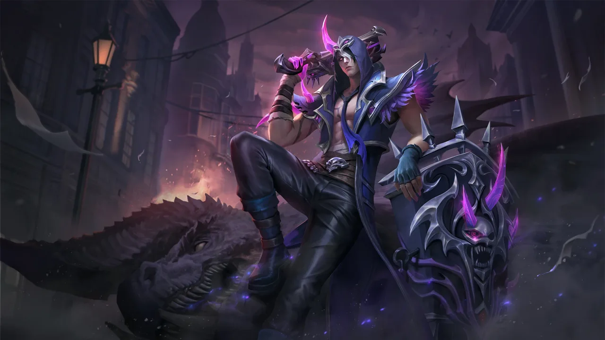
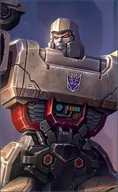

[Скины Грейнджера](https://boostmlbb.ru/skins/granger.html)

[Скины](https://boostmlbb.ru/skins/)/[Грейнджер](https://boostmlbb.ru/skins/granger.html)/Вестник ада

[Скин Грейнджера](https://boostmlbb.ru/skins/granger.html)

# Вестник ада

Hellbringer

Исключительный ExceptionalКонкурс обликовВ продаже

Как получить

Продаётся в магазине обликов за 749 алмазов.

Цена

749 алмазов

Вышел

18 февраля 2023

## Что меняет облик

-   Новая внешность
-   Новые эффекты навыков
-   Анимация показа
-   Бонус к характеристикам

## Все скины Грейнджера [12](https://boostmlbb.ru/skins/granger.html)

[Рождённый светом: ПодавительДелюкс · 2024](https://boostmlbb.ru/skins/granger/lightborn-overrider.html)[Манящая загадкаДелюкс · 2024](https://boostmlbb.ru/skins/granger/alluring-enigma.html)[Экзорцист ГрейнджерГрандиозный · 2023](https://boostmlbb.ru/skins/granger/exorcist-granger.html)[Вестник адаИсключительный · 2023](https://boostmlbb.ru/skins/granger/hellbringer.html)[МегатронГрандиозный · 2023](https://boostmlbb.ru/skins/granger/megatron.html)[Рыцарь звездопадаВысший · 2021](https://boostmlbb.ru/skins/granger/starfall-knight.html)[Агент ZИзысканный · 2020](https://boostmlbb.ru/skins/granger/agent-z.html)[БиосолдатИсключительный · 2020](https://boostmlbb.ru/skins/granger/biosoldier.html)[Терминатор судного дняОбычный · 2019](https://boostmlbb.ru/skins/granger/doomsday-terminator.html)[Шёпот бардаОбычный · 2019](https://boostmlbb.ru/skins/granger/bardic-whisper.html)[Косми­ческий финал](https://boostmlbb.ru/skins/granger/cosmic-finality.html)[Восходящий гром](https://boostmlbb.ru/skins/granger/thunder-ascendant.html)

## Серия «Конкурс обликов»

[Восходящий пламениЗилонг · 2026](https://boostmlbb.ru/skins/zilong/ascendant-of-flame.html)[Звёздная матронаЛо Йи · 2025](https://boostmlbb.ru/skins/luo-yi/starborne-matron.html)[Сердце моряКадита · 2024](https://boostmlbb.ru/skins/kadita/heart-of-the-sea.html)[Мудрица теченийОдетта · 2020](https://boostmlbb.ru/skins/odette/sage-of-the-currents.html)[Кибер-призракНаталья · 2020](https://boostmlbb.ru/skins/natalia/cyber-spectre.html)

**Сколько стоит буст на герое Грейнджер?**Выберите текущий и желаемый ранг. Стоимость появится на сайте.

[Рассчитать цену](https://boostmlbb.ru/order.html?type=hero)

## Частые вопросы

Как получить скин «Вестник ада» на Грейнджера?

Продаётся в магазине обликов за 749 алмазов.

Когда вышел скин «Вестник ада»?

18 февраля 2023.

Какой класс у скина «Вестник ада»?

Исключительный (Exceptional), серия «Конкурс обликов».
