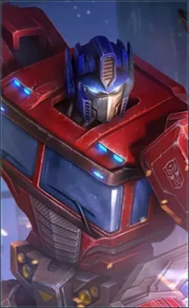
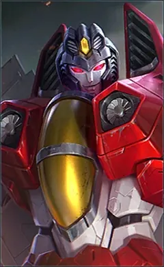

[Скины Грейнджера](https://boostmlbb.ru/skins/granger.html)

[Скины](https://boostmlbb.ru/skins/)/[Грейнджер](https://boostmlbb.ru/skins/granger.html)/Мегатрон

[Скин Грейнджера](https://boostmlbb.ru/skins/granger.html)

# Мегатрон

Megatron

Грандиозный GrandТрансформерыОграниченный

Как получить

Выходил в событии коллаборации MLBB × Transformers.

Вышел

18 февраля 2023

## Что меняет облик

-   Новая внешность
-   Новые эффекты навыков
-   Звуки навыков
-   Своя озвучка
-   Иконки навыков
-   Анимация показа
-   Сцена показа
-   Бонус к характеристикам

## Все скины Грейнджера [12](https://boostmlbb.ru/skins/granger.html)

[Рождённый светом: ПодавительДелюкс · 2024](https://boostmlbb.ru/skins/granger/lightborn-overrider.html)[Манящая загадкаДелюкс · 2024](https://boostmlbb.ru/skins/granger/alluring-enigma.html)[Экзорцист ГрейнджерГрандиозный · 2023](https://boostmlbb.ru/skins/granger/exorcist-granger.html)[Вестник адаИсключительный · 2023](https://boostmlbb.ru/skins/granger/hellbringer.html)[МегатронГрандиозный · 2023](https://boostmlbb.ru/skins/granger/megatron.html)[Рыцарь звездопадаВысший · 2021](https://boostmlbb.ru/skins/granger/starfall-knight.html)[Агент ZИзысканный · 2020](https://boostmlbb.ru/skins/granger/agent-z.html)[БиосолдатИсключительный · 2020](https://boostmlbb.ru/skins/granger/biosoldier.html)[Терминатор судного дняОбычный · 2019](https://boostmlbb.ru/skins/granger/doomsday-terminator.html)[Шёпот бардаОбычный · 2019](https://boostmlbb.ru/skins/granger/bardic-whisper.html)[Косми­ческий финал](https://boostmlbb.ru/skins/granger/cosmic-finality.html)[Восходящий гром](https://boostmlbb.ru/skins/granger/thunder-ascendant.html)

## Серия «Трансформеры»

[БамблбиИкс.Борг · 2025](https://boostmlbb.ru/skins/x-borg/bumblebee.html)[Оптимус ПраймДжонсон · 2023](https://boostmlbb.ru/skins/johnson/optimus-prime.html)[Саундвейв и РэвиджПополь и Купа · 2022](https://boostmlbb.ru/skins/popol-and-kupa/soundwave-ravage.html)[СтарскримАлдос · 2022](https://boostmlbb.ru/skins/aldous/starscream.html)[ГримлокРоджер · 2022](https://boostmlbb.ru/skins/roger/grimlock.html)

**Сколько стоит буст на герое Грейнджер?**Выберите текущий и желаемый ранг. Стоимость появится на сайте.

[Рассчитать цену](https://boostmlbb.ru/order.html?type=hero)

## Частые вопросы

Как получить скин «Мегатрон» на Грейнджера?

Выходил в событии коллаборации MLBB × Transformers.

Когда вышел скин «Мегатрон»?

18 февраля 2023.

Какой класс у скина «Мегатрон»?

Грандиозный (Grand), серия «Трансформеры».
