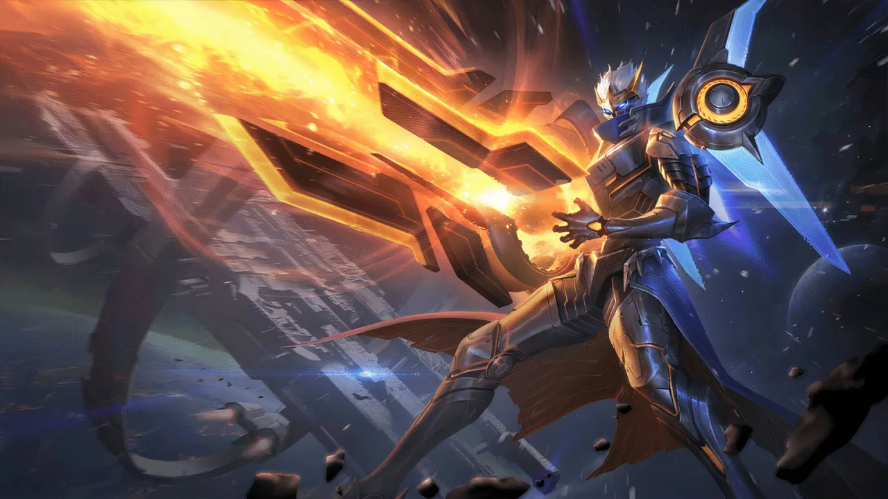

[Тир-лист](https://boostmlbb.ru/heroes/)[Предметы](https://boostmlbb.ru/items/)[Скины](https://boostmlbb.ru/skins/)[Новости и гайды](https://boostmlbb.ru/news/)

[Скины](https://boostmlbb.ru/skins/)/[Грейнджер](https://boostmlbb.ru/skins/granger.html)/Рыцарь звездопада

[Скин Грейнджера](https://boostmlbb.ru/skins/granger.html)

# Рыцарь звездопада

Starfall Knight

Высший SupremeЛегендарныйОграниченный

Как получить

Обменивается на магические кристаллы из Магического колеса. Ограниченные облики иногда возвращаются в розыгрышах событий.

Вышел

23 апреля 2021

## Что меняет облик

-   Новая внешность
-   Новые эффекты навыков
-   Анимации навыков
-   Звуки навыков
-   Своя озвучка
-   Иконки навыков
-   Анимация показа
-   Сцена показа
-   Эффект возвращения
-   Рамка аватара
-   Достижение
-   Бонус к характеристикам

## Все скины Грейнджера [12](https://boostmlbb.ru/skins/granger.html)

[Рождённый светом: ПодавительДелюкс · 2024](https://boostmlbb.ru/skins/granger/lightborn-overrider.html)[Манящая загадкаДелюкс · 2024](https://boostmlbb.ru/skins/granger/alluring-enigma.html)[Экзорцист ГрейнджерГрандиозный · 2023](https://boostmlbb.ru/skins/granger/exorcist-granger.html)[Вестник адаИсключительный · 2023](https://boostmlbb.ru/skins/granger/hellbringer.html)[МегатронГрандиозный · 2023](https://boostmlbb.ru/skins/granger/megatron.html)[Рыцарь звездопадаВысший · 2021](https://boostmlbb.ru/skins/granger/starfall-knight.html)[Агент ZИзысканный · 2020](https://boostmlbb.ru/skins/granger/agent-z.html)[БиосолдатИсключительный · 2020](https://boostmlbb.ru/skins/granger/biosoldier.html)[Терминатор судного дняОбычный · 2019](https://boostmlbb.ru/skins/granger/doomsday-terminator.html)[Шёпот бардаОбычный · 2019](https://boostmlbb.ru/skins/granger/bardic-whisper.html)[Косми­ческий финал](https://boostmlbb.ru/skins/granger/cosmic-finality.html)[Восходящий гром](https://boostmlbb.ru/skins/granger/thunder-ascendant.html)

## Серия «Легендарный»

[Призрак розАльфа · 2025](https://boostmlbb.ru/skins/alpha/revenant-of-roses.html)[Повелитель мировДжонсон · 2025](https://boostmlbb.ru/skins/johnson/sovereign-of-realms.html)[Галакти­ческая победи­тельницаФрейя · 2024](https://boostmlbb.ru/skins/freya/galactic-vanquisher.html)[Божествен­ная богиняЛюнокс · 2023](https://boostmlbb.ru/skins/lunox/divine-goddess.html)[Король адаФранко · 2023](https://boostmlbb.ru/skins/franco/king-of-hell.html)[Псион будущегоГвиневра · 2022](https://boostmlbb.ru/skins/guinevere/psion-of-tomorrow.html)[Адское пламяВалир · 2022](https://boostmlbb.ru/skins/valir/infernal-blaze.html)[Косми­ческий отблескГоссен · 2022](https://boostmlbb.ru/skins/gusion/cosmic-gleam.html)

**Поднимем ранг на герое Грейнджер**Цена считается в калькуляторе

[Рассчитать цену](https://boostmlbb.ru/order.html?type=hero)

## Частые вопросы

Как получить скин «Рыцарь звездопада» на Грейнджера?

Обменивается на магические кристаллы из Магического колеса. Ограниченные облики иногда возвращаются в розыгрышах событий.

Когда вышел скин «Рыцарь звездопада»?

23 апреля 2021.

Какой класс у скина «Рыцарь звездопада»?

Высший (Supreme), серия «Легендарный».
