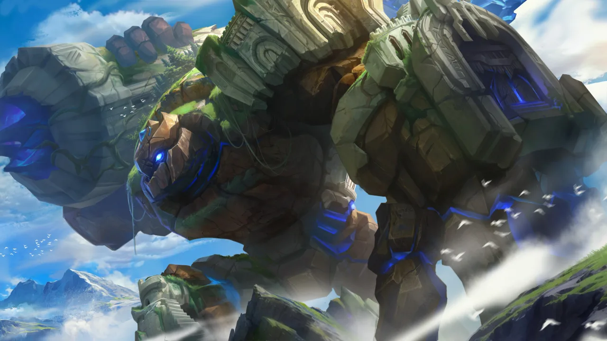

[Тир-лист](https://boostmlbb.ru/heroes/)[Предметы](https://boostmlbb.ru/items/)[Скины](https://boostmlbb.ru/skins/)[Новости и гайды](https://boostmlbb.ru/news/)

[Скины](https://boostmlbb.ru/skins/)/Грок

# Скины Грока

Скинов

8

Можно купить

4

Последний

[Дрожь глубин](https://boostmlbb.ru/skins/grock/tremor-of-the-deep.html)2026

[Профиль героя→](https://boostmlbb.ru/heroes/grock.html)

## Все скины

ВсеДелюксИсключительныйОбычный

[Дрожь глубин2026](https://boostmlbb.ru/skins/grock/tremor-of-the-deep.html)[Кодовое имя: НосорогДелюкс · 2020](https://boostmlbb.ru/skins/grock/codename-rhino.html)[Древний големОбычный · 2019](https://boostmlbb.ru/skins/grock/ancient-golem.html)[Варан V.E.N.O.M.Делюкс · 2019](https://boostmlbb.ru/skins/grock/v-e-n-o-m-monitor-lizard.html)[Ледяной големИсключительный · 2019](https://boostmlbb.ru/skins/grock/iceland-golem.html)[Псих пустошейИсключительный · 2018](https://boostmlbb.ru/skins/grock/wasteland-psycho.html)[Страж замкаОбычный · 2018](https://boostmlbb.ru/skins/grock/castle-guard.html)[Страж могилОбычный · 2017](https://boostmlbb.ru/skins/grock/grave-guardian.html)

**Поднимем ранг на герое Грок**Цена считается в калькуляторе

[Рассчитать цену](https://boostmlbb.ru/order.html?type=hero)

## Частые вопросы

Сколько скинов у Грока?

8 скинов без стандартного облика. Последний — «Дрожь глубин» (Tremor of the Deep), апрель 2026.

Какие скины Грока можно купить сейчас?

«Кодовое имя: Носорог» (899 алмазов), «Варан V.E.N.O.M.» (899 алмазов), «Страж замка» (599 алмазов), «Страж могил» (269 алмазов). Остальные облики ограниченные и возвращаются только в событиях.

Какой самый редкий скин Грока?

«Кодовое имя: Носорог» (Codename: Rhino), класс делюкс, серия «Эпический». Продаётся в магазине обликов за 899 алмазов.
