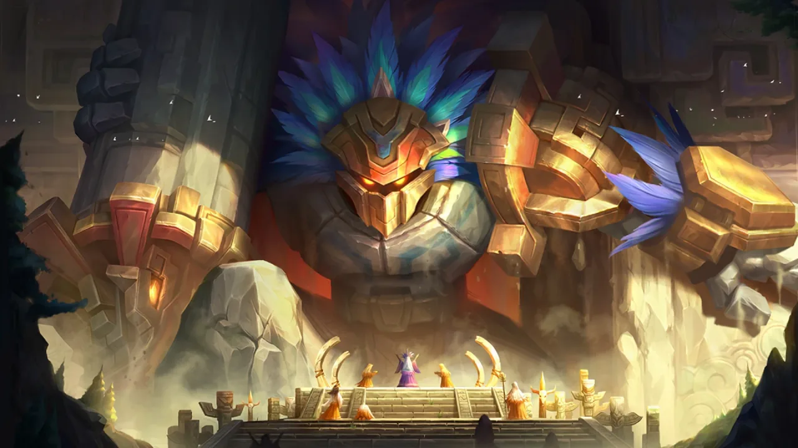

[Скины Грока](https://boostmlbb.ru/skins/grock.html)

[Скины](https://boostmlbb.ru/skins/)/[Грок](https://boostmlbb.ru/skins/grock.html)/Древний голем

[Скин Грока](https://boostmlbb.ru/skins/grock.html)

# Древний голем

Ancient Golem

Обычный CommonСезон 24Ограниченный

Как получить

Награда за рейтинговый сезон 24.

Вышел

2 ноября 2019

## Что меняет облик

-   Новая внешность
-   Другой цвет эффектов
-   Анимация показа
-   Бонус к характеристикам

## Все скины Грока [8](https://boostmlbb.ru/skins/grock.html)

[Дрожь глубин2026](https://boostmlbb.ru/skins/grock/tremor-of-the-deep.html)[Кодовое имя: НосорогДелюкс · 2020](https://boostmlbb.ru/skins/grock/codename-rhino.html)[Древний големОбычный · 2019](https://boostmlbb.ru/skins/grock/ancient-golem.html)[Варан V.E.N.O.M.Делюкс · 2019](https://boostmlbb.ru/skins/grock/v-e-n-o-m-monitor-lizard.html)[Ледяной големИсключительный · 2019](https://boostmlbb.ru/skins/grock/iceland-golem.html)[Псих пустошейИсключительный · 2018](https://boostmlbb.ru/skins/grock/wasteland-psycho.html)[Страж замкаОбычный · 2018](https://boostmlbb.ru/skins/grock/castle-guard.html)[Страж могилОбычный · 2017](https://boostmlbb.ru/skins/grock/grave-guardian.html)

**Сколько стоит буст на герое Грок?**Выберите текущий и желаемый ранг. Стоимость появится на сайте.

[Рассчитать цену](https://boostmlbb.ru/order.html?type=hero)

## Частые вопросы

Как получить скин «Древний голем» на Грока?

Награда за рейтинговый сезон 24.

Когда вышел скин «Древний голем»?

2 ноября 2019.

Какой класс у скина «Древний голем»?

Обычный (Common), серия «Сезон 24».
