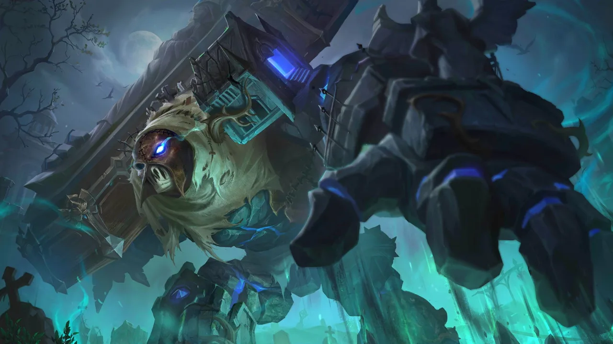

[Скины Грока](https://boostmlbb.ru/skins/grock.html)

[Скины](https://boostmlbb.ru/skins/)/[Грок](https://boostmlbb.ru/skins/grock.html)/Страж могил

[Скин Грока](https://boostmlbb.ru/skins/grock.html)

# Страж могил

Grave Guardian

Обычный CommonВ продаже

Как получить

Продаётся в магазине обликов за 269 алмазов.

Цена

269 алмазов

Вышел

29 сентября 2017

## Что меняет облик

-   Бонус к характеристикам

## Все скины Грока [8](https://boostmlbb.ru/skins/grock.html)

[Дрожь глубин2026](https://boostmlbb.ru/skins/grock/tremor-of-the-deep.html)[Кодовое имя: НосорогДелюкс · 2020](https://boostmlbb.ru/skins/grock/codename-rhino.html)[Древний големОбычный · 2019](https://boostmlbb.ru/skins/grock/ancient-golem.html)[Варан V.E.N.O.M.Делюкс · 2019](https://boostmlbb.ru/skins/grock/v-e-n-o-m-monitor-lizard.html)[Ледяной големИсключительный · 2019](https://boostmlbb.ru/skins/grock/iceland-golem.html)[Псих пустошейИсключительный · 2018](https://boostmlbb.ru/skins/grock/wasteland-psycho.html)[Страж замкаОбычный · 2018](https://boostmlbb.ru/skins/grock/castle-guard.html)[Страж могилОбычный · 2017](https://boostmlbb.ru/skins/grock/grave-guardian.html)

**Сколько стоит буст на герое Грок?**Выберите текущий и желаемый ранг. Стоимость появится на сайте.

[Рассчитать цену](https://boostmlbb.ru/order.html?type=hero)

## Частые вопросы

Как получить скин «Страж могил» на Грока?

Продаётся в магазине обликов за 269 алмазов.

Когда вышел скин «Страж могил»?

29 сентября 2017.

Какой класс у скина «Страж могил»?

Обычный (Common).
