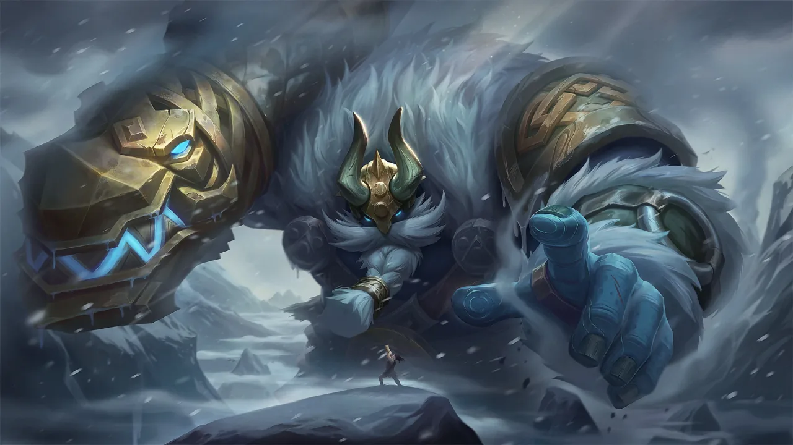

[Скины Грока](https://boostmlbb.ru/skins/grock.html)

[Скины](https://boostmlbb.ru/skins/)/[Грок](https://boostmlbb.ru/skins/grock.html)/Ледяной голем

[Скин Грока](https://boostmlbb.ru/skins/grock.html)

# Ледяной голем

Iceland Golem

Исключительный ExceptionalЗвёздный участникОграниченный

Как получить

Награда «Звёздного участника» в ноябре 2019.

Вышел

1 ноября 2019

## Что меняет облик

-   Новая внешность
-   Новые эффекты навыков
-   Анимация показа
-   Сцена показа
-   Бонус к характеристикам

## Все скины Грока [8](https://boostmlbb.ru/skins/grock.html)

[Дрожь глубин2026](https://boostmlbb.ru/skins/grock/tremor-of-the-deep.html)[Кодовое имя: НосорогДелюкс · 2020](https://boostmlbb.ru/skins/grock/codename-rhino.html)[Древний големОбычный · 2019](https://boostmlbb.ru/skins/grock/ancient-golem.html)[Варан V.E.N.O.M.Делюкс · 2019](https://boostmlbb.ru/skins/grock/v-e-n-o-m-monitor-lizard.html)[Ледяной големИсключительный · 2019](https://boostmlbb.ru/skins/grock/iceland-golem.html)[Псих пустошейИсключительный · 2018](https://boostmlbb.ru/skins/grock/wasteland-psycho.html)[Страж замкаОбычный · 2018](https://boostmlbb.ru/skins/grock/castle-guard.html)[Страж могилОбычный · 2017](https://boostmlbb.ru/skins/grock/grave-guardian.html)

## Серия «Звёздный участник»

[Морячка, рождённая приливомКалеа · 2026](https://boostmlbb.ru/skins/kalea/tideborn-sailor.html)[Тень кицунэХаябуса · 2026](https://boostmlbb.ru/skins/hayabusa/kitsune-s-shadow.html)[Клыки резниХанзо · 2026](https://boostmlbb.ru/skins/hanzo/fangs-of-slaughter.html)[Тлеющая крепостьБелерик · 2026](https://boostmlbb.ru/skins/belerick/smouldering-fortress.html)[Магитех­нический призракОбсидия · 2026](https://boostmlbb.ru/skins/obsidia/magitech-wraith.html)[Элизийское сияниеЦзэтянь · 2026](https://boostmlbb.ru/skins/zetian/elysian-luminance.html)[Батальон стражейХильда · 2026](https://boostmlbb.ru/skins/hilda/guardian-battalion.html)[Мечта­тельный коиХарли · 2026](https://boostmlbb.ru/skins/harley/dreaming-koi.html)

**Сколько стоит буст на герое Грок?**Выберите текущий и желаемый ранг. Стоимость появится на сайте.

[Рассчитать цену](https://boostmlbb.ru/order.html?type=hero)

## Частые вопросы

Как получить скин «Ледяной голем» на Грока?

Награда «Звёздного участника» в ноябре 2019.

Когда вышел скин «Ледяной голем»?

1 ноября 2019.

Какой класс у скина «Ледяной голем»?

Исключительный (Exceptional), серия «Звёздный участник».
