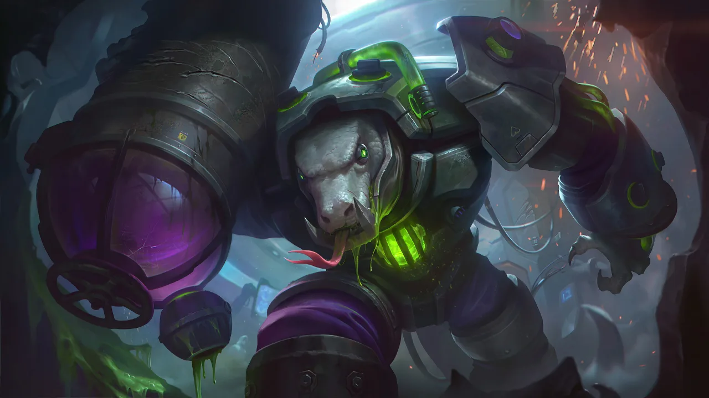

[Скины Грока](https://boostmlbb.ru/skins/grock.html)

[Скины](https://boostmlbb.ru/skins/)/[Грок](https://boostmlbb.ru/skins/grock.html)/Варан V.E.N.O.M.

[Скин Грока](https://boostmlbb.ru/skins/grock.html)

# Варан V.E.N.O.M.

V.E.N.O.M. Monitor Lizard

Делюкс DeluxeV.E.N.O.M.В продаже

Как получить

Продаётся в магазине обликов за 899 алмазов.

Цена

899 алмазов

Вышел

2 ноября 2019

## Что меняет облик

-   Новая внешность
-   Новые эффекты навыков
-   Анимация показа
-   Сцена показа
-   Бонус к характеристикам

## Все скины Грока [8](https://boostmlbb.ru/skins/grock.html)

[Дрожь глубин2026](https://boostmlbb.ru/skins/grock/tremor-of-the-deep.html)[Кодовое имя: НосорогДелюкс · 2020](https://boostmlbb.ru/skins/grock/codename-rhino.html)[Древний големОбычный · 2019](https://boostmlbb.ru/skins/grock/ancient-golem.html)[Варан V.E.N.O.M.Делюкс · 2019](https://boostmlbb.ru/skins/grock/v-e-n-o-m-monitor-lizard.html)[Ледяной големИсключительный · 2019](https://boostmlbb.ru/skins/grock/iceland-golem.html)[Псих пустошейИсключительный · 2018](https://boostmlbb.ru/skins/grock/wasteland-psycho.html)[Страж замкаОбычный · 2018](https://boostmlbb.ru/skins/grock/castle-guard.html)[Страж могилОбычный · 2017](https://boostmlbb.ru/skins/grock/grave-guardian.html)

## Серия «V.E.N.O.M.»

[Кобра V.E.N.O.M.Дариус · 2022](https://boostmlbb.ru/skins/dyrroth/v-e-n-o-m-cobra.html)[Нефила V.E.N.O.M.Ханаби · 2019](https://boostmlbb.ru/skins/hanabi/v-e-n-o-m-nephila.html)[Импера­торский скорпион V.E.N.O.M.Госсен · 2019](https://boostmlbb.ru/skins/gusion/v-e-n-o-m-emperor-scorpion.html)[Оса V.E.N.O.M.Ангела · 2019](https://boostmlbb.ru/skins/angela/v-e-n-o-m-vespid.html)[Осьминог V.E.N.O.M.Харли · 2019](https://boostmlbb.ru/skins/harley/v-e-n-o-m-octopus.html)

**Сколько стоит буст на герое Грок?**Выберите текущий и желаемый ранг. Стоимость появится на сайте.

[Рассчитать цену](https://boostmlbb.ru/order.html?type=hero)

## Частые вопросы

Как получить скин «Варан V.E.N.O.M.» на Грока?

Продаётся в магазине обликов за 899 алмазов.

Когда вышел скин «Варан V.E.N.O.M.»?

2 ноября 2019.

Какой класс у скина «Варан V.E.N.O.M.»?

Делюкс (Deluxe), серия «V.E.N.O.M.».
