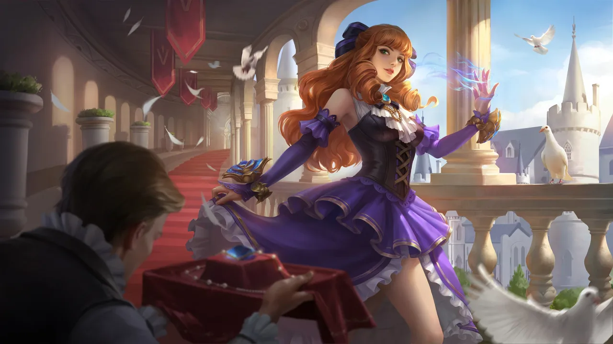

[Тир-лист](https://boostmlbb.ru/heroes/)[Предметы](https://boostmlbb.ru/items/)[Скины](https://boostmlbb.ru/skins/)[Новости и гайды](https://boostmlbb.ru/news/)

[Скины](https://boostmlbb.ru/skins/)/Гвиневра

# Скины Гвиневры

Скинов

10

Можно купить

3

Последний

[Сияние рассвета](https://boostmlbb.ru/skins/guinevere/daybreak-halo.html)2025

[Профиль героя→](https://boostmlbb.ru/heroes/guinevere.html)

## Все скины

ВсеВысшийГрандиозныйИзысканныйИсключительныйОбычный

[Сияние рассветаГрандиозный · 2025](https://boostmlbb.ru/skins/guinevere/daybreak-halo.html)[Леди-журавльИзысканный · 2025](https://boostmlbb.ru/skins/guinevere/lady-crane.html)[Изящная бабочкаОбычный · 2024](https://boostmlbb.ru/skins/guinevere/elegant-butterfly.html)[Летний бризИсключительный · 2024](https://boostmlbb.ru/skins/guinevere/summer-breeze.html)[Псион будущегоВысший · 2022](https://boostmlbb.ru/skins/guinevere/psion-of-tomorrow.html)[Желания сакурыИсключительный · 2020](https://boostmlbb.ru/skins/guinevere/sakura-wishes.html)[Аметис­товый танецИсключительный · 2020](https://boostmlbb.ru/skins/guinevere/amethyst-dance.html)[ЛотосИсключительный · 2019](https://boostmlbb.ru/skins/guinevere/lotus.html)[Афина АсамияГрандиозный · 2019](https://boostmlbb.ru/skins/guinevere/athena-asamiya.html)[Синий цветокОбычный · 2019](https://boostmlbb.ru/skins/guinevere/fleur-de-bleau.html)

**Поднимем ранг на герое Гвиневра**Цена считается в калькуляторе

[Рассчитать цену](https://boostmlbb.ru/order.html?type=hero)

## Частые вопросы

Сколько скинов у Гвиневры?

10 скинов без стандартного облика. Последний — «Сияние рассвета» (Daybreak Halo), 3 октября 2025.

Какие скины Гвиневры можно купить сейчас?

«Желания сакуры» (749 алмазов), «Аметистовый танец» (749 алмазов), «Синий цветок» (269 алмазов). Остальные облики ограниченные и возвращаются только в событиях.

Какой самый редкий скин Гвиневры?

«Псион будущего» (Psion of Tomorrow), класс высший, серия «Легендарный». Обменивается на магические кристаллы из Магического колеса. Ограниченные облики иногда возвращаются в розыгрышах событий.
