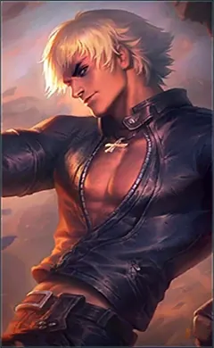

[Тир-лист](https://boostmlbb.ru/heroes/)[Предметы](https://boostmlbb.ru/items/)[Скины](https://boostmlbb.ru/skins/)[Новости и гайды](https://boostmlbb.ru/news/)

[Скины](https://boostmlbb.ru/skins/)/[Гвиневра](https://boostmlbb.ru/skins/guinevere.html)/Афина Асамия

[Скин Гвиневры](https://boostmlbb.ru/skins/guinevere.html)

# Афина Асамия

Athena Asamiya

Грандиозный GrandThe King of FightersОграниченный

Как получить

Выходил в событии коллаборации MLBB × The King of Fighters.

Вышел

март 2019

## Что меняет облик

-   Новая внешность
-   Новые эффекты навыков
-   Звуки навыков
-   Своя озвучка
-   Иконки навыков
-   Анимация показа
-   Сцена показа
-   Музыка показа
-   Анимация появления
-   Особые действия
-   Бонус к характеристикам

## Все скины Гвиневры [10](https://boostmlbb.ru/skins/guinevere.html)

[Сияние рассветаГрандиозный · 2025](https://boostmlbb.ru/skins/guinevere/daybreak-halo.html)[Леди-журавльИзысканный · 2025](https://boostmlbb.ru/skins/guinevere/lady-crane.html)[Изящная бабочкаОбычный · 2024](https://boostmlbb.ru/skins/guinevere/elegant-butterfly.html)[Летний бризИсключительный · 2024](https://boostmlbb.ru/skins/guinevere/summer-breeze.html)[Псион будущегоВысший · 2022](https://boostmlbb.ru/skins/guinevere/psion-of-tomorrow.html)[Желания сакурыИсключительный · 2020](https://boostmlbb.ru/skins/guinevere/sakura-wishes.html)[Аметис­товый танецИсключительный · 2020](https://boostmlbb.ru/skins/guinevere/amethyst-dance.html)[ЛотосИсключительный · 2019](https://boostmlbb.ru/skins/guinevere/lotus.html)[Афина АсамияГрандиозный · 2019](https://boostmlbb.ru/skins/guinevere/athena-asamiya.html)[Синий цветокОбычный · 2019](https://boostmlbb.ru/skins/guinevere/fleur-de-bleau.html)

## Серия «The King of Fighters»

[Кё КусанагиВалир · 2024](https://boostmlbb.ru/skins/valir/kyo-kusanagi.html)[Терри БогардПакито · 2024](https://boostmlbb.ru/skins/paquito/terry-bogard.html)[Май ШирануиМаша · 2024](https://boostmlbb.ru/skins/masha/mai-shiranui.html)[К'Госсен · 2024](https://boostmlbb.ru/skins/gusion/k.html)[Орочи КрисДариус · 2020](https://boostmlbb.ru/skins/dyrroth/orochi-chris.html)[Кула ДаймондАврора · 2019](https://boostmlbb.ru/skins/aurora/kula-diamond.html)[Иори ЯгамиЧу · 2019](https://boostmlbb.ru/skins/chou/iori-yagami.html)[ЛеонаКарина · 2019](https://boostmlbb.ru/skins/karina/leona.html)

**Поднимем ранг на герое Гвиневра**Цена считается в калькуляторе

[Рассчитать цену](https://boostmlbb.ru/order.html?type=hero)

## Частые вопросы

Как получить скин «Афина Асамия» на Гвиневру?

Выходил в событии коллаборации MLBB × The King of Fighters.

Когда вышел скин «Афина Асамия»?

Март 2019.

Какой класс у скина «Афина Асамия»?

Грандиозный (Grand), серия «The King of Fighters».
