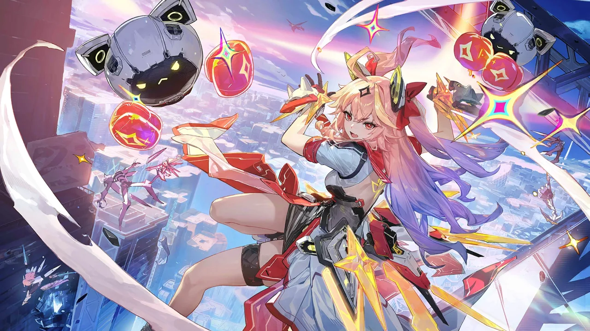

[Скины Гвиневры](https://boostmlbb.ru/skins/guinevere.html)

[Скины](https://boostmlbb.ru/skins/)/[Гвиневра](https://boostmlbb.ru/skins/guinevere.html)/Сияние рассвета

[Скин Гвиневры](https://boostmlbb.ru/skins/guinevere.html)

# Сияние рассвета

Daybreak Halo

Грандиозный GrandПретендентыОграниченный

Как получить

Выходил в событии «Претенденты». Ограниченные облики иногда возвращаются в розыгрышах событий.

Вышел

3 октября 2025

## Что меняет облик

-   Новая внешность
-   Новые эффекты навыков
-   Звуки навыков
-   Своя озвучка
-   Иконки навыков
-   Анимация показа
-   Сцена показа
-   Музыка показа
-   Анимация появления
-   Особые действия
-   Бонус к характеристикам

## Все скины Гвиневры [10](https://boostmlbb.ru/skins/guinevere.html)

[Сияние рассветаГрандиозный · 2025](https://boostmlbb.ru/skins/guinevere/daybreak-halo.html)[Леди-журавльИзысканный · 2025](https://boostmlbb.ru/skins/guinevere/lady-crane.html)[Изящная бабочкаОбычный · 2024](https://boostmlbb.ru/skins/guinevere/elegant-butterfly.html)[Летний бризИсключительный · 2024](https://boostmlbb.ru/skins/guinevere/summer-breeze.html)[Псион будущегоВысший · 2022](https://boostmlbb.ru/skins/guinevere/psion-of-tomorrow.html)[Желания сакурыИсключительный · 2020](https://boostmlbb.ru/skins/guinevere/sakura-wishes.html)[Аметис­товый танецИсключительный · 2020](https://boostmlbb.ru/skins/guinevere/amethyst-dance.html)[ЛотосИсключительный · 2019](https://boostmlbb.ru/skins/guinevere/lotus.html)[Афина АсамияГрандиозный · 2019](https://boostmlbb.ru/skins/guinevere/athena-asamiya.html)[Синий цветокОбычный · 2019](https://boostmlbb.ru/skins/guinevere/fleur-de-bleau.html)

## Серия «Претенденты»

[Райко Серебряная МолнияСелена · 2026](https://boostmlbb.ru/skins/selena/silverbolt-raiko.html)[Импе­ратрица АрасиОбсидия · 2026](https://boostmlbb.ru/skins/obsidia/imperatrix-arashi.html)[Сумеречная звездаВексана · 2025](https://boostmlbb.ru/skins/vexana/twilight-star.html)[Техни­ческий генийЧан'Э · 2024](https://boostmlbb.ru/skins/change/tech-tensai.html)[Меткий призракЛесли · 2024](https://boostmlbb.ru/skins/lesley/deadeye-spectre.html)[Меха-деваРуби · 2023](https://boostmlbb.ru/skins/ruby/mecha-maiden.html)[Клинок надеждыФанни · 2022](https://boostmlbb.ru/skins/fanny/blade-of-kibou.html)[Мисс ХикариЛейла · 2022](https://boostmlbb.ru/skins/layla/miss-hikari.html)

**Сколько стоит буст на герое Гвиневра?**Выберите текущий и желаемый ранг. Стоимость появится на сайте.

[Рассчитать цену](https://boostmlbb.ru/order.html?type=hero)

## Частые вопросы

Как получить скин «Сияние рассвета» на Гвиневру?

Выходил в событии «Претенденты». Ограниченные облики иногда возвращаются в розыгрышах событий.

Когда вышел скин «Сияние рассвета»?

3 октября 2025.

Какой класс у скина «Сияние рассвета»?

Грандиозный (Grand), серия «Претенденты».
