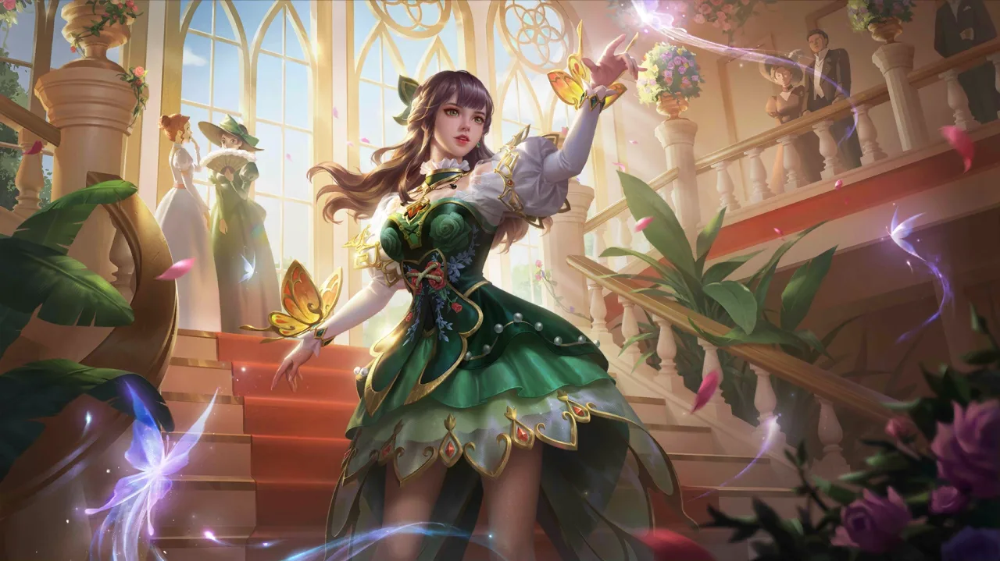

[Скины Гвиневры](https://boostmlbb.ru/skins/guinevere.html)

[Скины](https://boostmlbb.ru/skins/)/[Гвиневра](https://boostmlbb.ru/skins/guinevere.html)/Изящная бабочка

[Скин Гвиневры](https://boostmlbb.ru/skins/guinevere.html)

# Изящная бабочка

Elegant Butterfly

Обычный CommonЭлитныйОграниченный

Как получить

Подарок за первое пополнение в сезоне 31.

Вышел

16 марта 2024

## Что меняет облик

-   Новая внешность
-   Другой цвет эффектов
-   Анимация показа
-   Бонус к характеристикам

## Все скины Гвиневры [10](https://boostmlbb.ru/skins/guinevere.html)

[Сияние рассветаГрандиозный · 2025](https://boostmlbb.ru/skins/guinevere/daybreak-halo.html)[Леди-журавльИзысканный · 2025](https://boostmlbb.ru/skins/guinevere/lady-crane.html)[Изящная бабочкаОбычный · 2024](https://boostmlbb.ru/skins/guinevere/elegant-butterfly.html)[Летний бризИсключительный · 2024](https://boostmlbb.ru/skins/guinevere/summer-breeze.html)[Псион будущегоВысший · 2022](https://boostmlbb.ru/skins/guinevere/psion-of-tomorrow.html)[Желания сакурыИсключительный · 2020](https://boostmlbb.ru/skins/guinevere/sakura-wishes.html)[Аметис­товый танецИсключительный · 2020](https://boostmlbb.ru/skins/guinevere/amethyst-dance.html)[ЛотосИсключительный · 2019](https://boostmlbb.ru/skins/guinevere/lotus.html)[Афина АсамияГрандиозный · 2019](https://boostmlbb.ru/skins/guinevere/athena-asamiya.html)[Синий цветокОбычный · 2019](https://boostmlbb.ru/skins/guinevere/fleur-de-bleau.html)

## Серия «Элитный»

[Золотой османтусЧан'Э · 2026](https://boostmlbb.ru/skins/change/golden-osmanthus.html)[Король-воена­чальникМартис · 2025](https://boostmlbb.ru/skins/martis/warlord-king.html)[Кадет открытого моряКимми · 2024](https://boostmlbb.ru/skins/kimmy/high-seas-cadet.html)[Зелёная копейщицаСильвана · 2024](https://boostmlbb.ru/skins/silvanna/verdant-lancer.html)[Мародёр Кровавое КопытоХилос · 2024](https://boostmlbb.ru/skins/hylos/bloodhoof-marauder.html)[Маркиз клинковЛанселот · 2024](https://boostmlbb.ru/skins/lancelot/marques-of-blades.html)[Привал в пустошахЧип · 2024](https://boostmlbb.ru/skins/chip/badlands-hiatus.html)[Звёздный фокусникХарли · 2024](https://boostmlbb.ru/skins/harley/star-magician.html)

**Сколько стоит буст на герое Гвиневра?**Выберите текущий и желаемый ранг. Стоимость появится на сайте.

[Рассчитать цену](https://boostmlbb.ru/order.html?type=hero)

## Частые вопросы

Как получить скин «Изящная бабочка» на Гвиневру?

Подарок за первое пополнение в сезоне 31.

Когда вышел скин «Изящная бабочка»?

16 марта 2024.

Какой класс у скина «Изящная бабочка»?

Обычный (Common), серия «Элитный».
