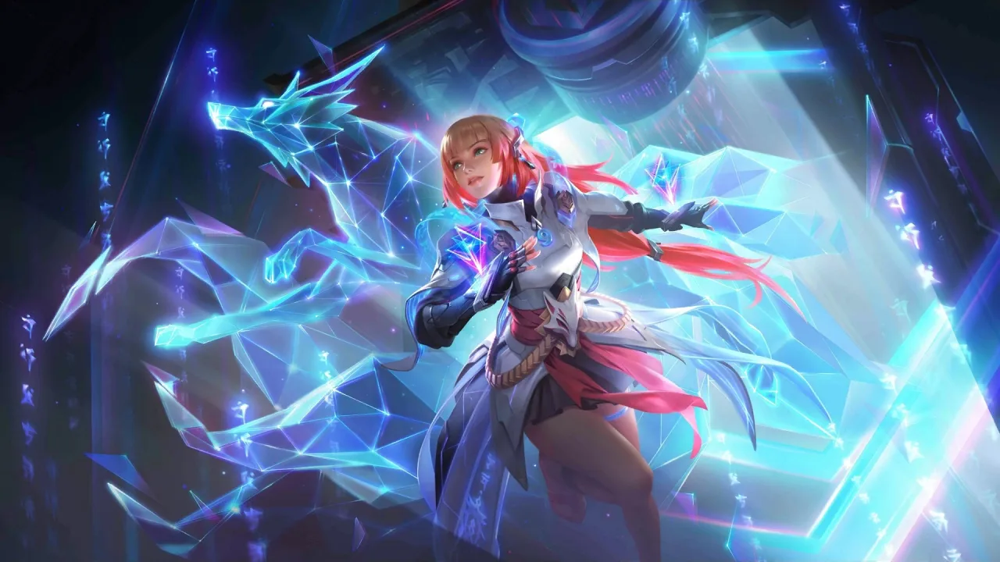

[Скины Гвиневры](https://boostmlbb.ru/skins/guinevere.html)

[Скины](https://boostmlbb.ru/skins/)/[Гвиневра](https://boostmlbb.ru/skins/guinevere.html)/Псион будущего

[Скин Гвиневры](https://boostmlbb.ru/skins/guinevere.html)

# Псион будущего

Psion of Tomorrow

Высший SupremeЛегендарныйОграниченный

Как получить

Обменивается на магические кристаллы из Магического колеса. Ограниченные облики иногда возвращаются в розыгрышах событий.

Вышел

25 апреля 2022

## Что меняет облик

-   Новая внешность
-   Новые эффекты навыков
-   Анимации навыков
-   Звуки навыков
-   Своя озвучка
-   Иконки навыков
-   Анимация показа
-   Сцена показа
-   Эффект возвращения
-   Особые действия
-   Рамка аватара
-   Достижение
-   Бонус к характеристикам

## Все скины Гвиневры [10](https://boostmlbb.ru/skins/guinevere.html)

[Сияние рассветаГрандиозный · 2025](https://boostmlbb.ru/skins/guinevere/daybreak-halo.html)[Леди-журавльИзысканный · 2025](https://boostmlbb.ru/skins/guinevere/lady-crane.html)[Изящная бабочкаОбычный · 2024](https://boostmlbb.ru/skins/guinevere/elegant-butterfly.html)[Летний бризИсключительный · 2024](https://boostmlbb.ru/skins/guinevere/summer-breeze.html)[Псион будущегоВысший · 2022](https://boostmlbb.ru/skins/guinevere/psion-of-tomorrow.html)[Желания сакурыИсключительный · 2020](https://boostmlbb.ru/skins/guinevere/sakura-wishes.html)[Аметис­товый танецИсключительный · 2020](https://boostmlbb.ru/skins/guinevere/amethyst-dance.html)[ЛотосИсключительный · 2019](https://boostmlbb.ru/skins/guinevere/lotus.html)[Афина АсамияГрандиозный · 2019](https://boostmlbb.ru/skins/guinevere/athena-asamiya.html)[Синий цветокОбычный · 2019](https://boostmlbb.ru/skins/guinevere/fleur-de-bleau.html)

## Серия «Легендарный»

[Призрак розАльфа · 2025](https://boostmlbb.ru/skins/alpha/revenant-of-roses.html)[Повелитель мировДжонсон · 2025](https://boostmlbb.ru/skins/johnson/sovereign-of-realms.html)[Галакти­ческая победи­тельницаФрейя · 2024](https://boostmlbb.ru/skins/freya/galactic-vanquisher.html)[Божествен­ная богиняЛюнокс · 2023](https://boostmlbb.ru/skins/lunox/divine-goddess.html)[Король адаФранко · 2023](https://boostmlbb.ru/skins/franco/king-of-hell.html)[Адское пламяВалир · 2022](https://boostmlbb.ru/skins/valir/infernal-blaze.html)[Косми­ческий отблескГоссен · 2022](https://boostmlbb.ru/skins/gusion/cosmic-gleam.html)[Рыцарь звездопадаГрейнджер · 2021](https://boostmlbb.ru/skins/granger/starfall-knight.html)

**Сколько стоит буст на герое Гвиневра?**Выберите текущий и желаемый ранг. Стоимость появится на сайте.

[Рассчитать цену](https://boostmlbb.ru/order.html?type=hero)

## Частые вопросы

Как получить скин «Псион будущего» на Гвиневру?

Обменивается на магические кристаллы из Магического колеса. Ограниченные облики иногда возвращаются в розыгрышах событий.

Когда вышел скин «Псион будущего»?

25 апреля 2022.

Какой класс у скина «Псион будущего»?

Высший (Supreme), серия «Легендарный».
