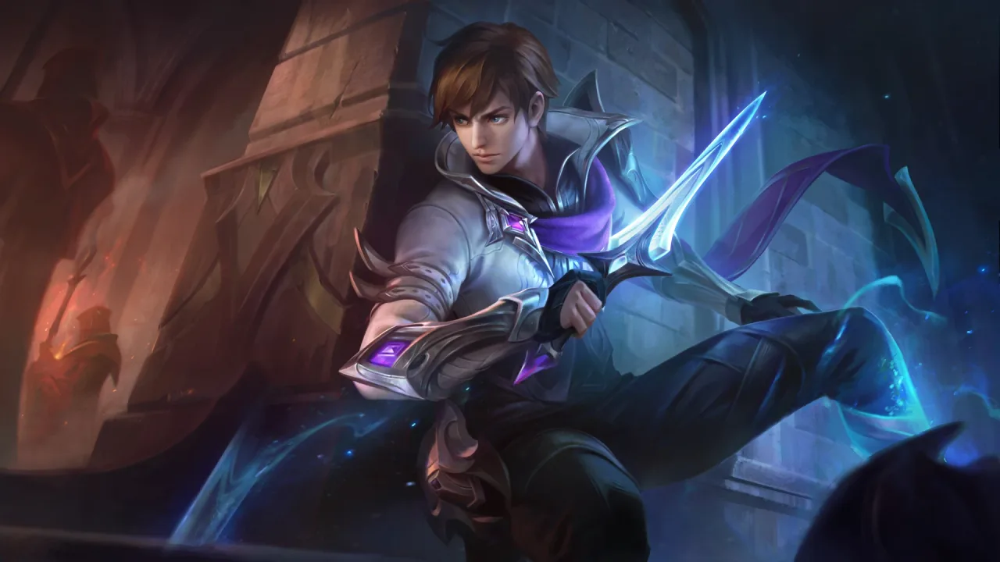
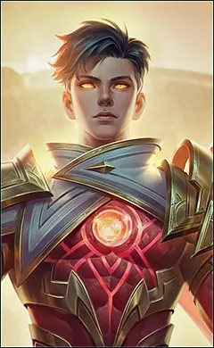

[Тир-лист](https://boostmlbb.ru/heroes/)[Предметы](https://boostmlbb.ru/items/)[Скины](https://boostmlbb.ru/skins/)[Новости и гайды](https://boostmlbb.ru/news/)

[Скины](https://boostmlbb.ru/skins/)/Госсен

# Скины Госсена

Скинов

12

Можно купить

6

Последний

[Пустынный паук](https://boostmlbb.ru/skins/gusion/desert-spider.html)2024

[Профиль героя→](https://boostmlbb.ru/heroes/gusion.html)

## Все скины

ВсеВысшийГрандиозныйИзысканныйДелюксИсключительныйОбычный

[Пустынный паукИсключительный · 2024](https://boostmlbb.ru/skins/gusion/desert-spider.html)[К'Грандиозный · 2024](https://boostmlbb.ru/skins/gusion/k.html)[Странник измеренийГрандиозный · 2023](https://boostmlbb.ru/skins/gusion/dimension-walker.html)[Откровение душиДелюкс · 2023](https://boostmlbb.ru/skins/gusion/soul-revelation.html)[Косми­ческий отблескВысший · 2022](https://boostmlbb.ru/skins/gusion/cosmic-gleam.html)[Ночная соваИзысканный · 2021](https://boostmlbb.ru/skins/gusion/night-owl.html)[Импера­торский скорпион V.E.N.O.M.Делюкс · 2019](https://boostmlbb.ru/skins/gusion/v-e-n-o-m-emperor-scorpion.html)[Опасная связьИсключительный · 2019](https://boostmlbb.ru/skins/gusion/dangerous-liaison.html)[КиберотрядИсключительный · 2018](https://boostmlbb.ru/skins/gusion/cyber-ops.html)[СтилистОбычный · 2018](https://boostmlbb.ru/skins/gusion/hairstylist.html)[Лунная сонатаОбычный · 2018](https://boostmlbb.ru/skins/gusion/moonlight-sonata.html)[Минато Намикадзе](https://boostmlbb.ru/skins/gusion/minato-namikaze.html)

**Поднимем ранг на герое Госсен**Цена считается в калькуляторе

[Рассчитать цену](https://boostmlbb.ru/order.html?type=hero)

## Частые вопросы

Сколько скинов у Госсена?

12 скинов без стандартного облика. Последний — «Пустынный паук» (Desert Spider), 1 июля 2024.

Какие скины Госсена можно купить сейчас?

«Откровение души» (899 алмазов), «Императорский скорпион V.E.N.O.M.» (899 алмазов), «Опасная связь» (749 алмазов), «Стилист» (599 алмазов), «Лунная соната» (269 алмазов). Остальные облики ограниченные и возвращаются только в событиях.

Какой самый редкий скин Госсена?

«Космический отблеск» (Cosmic Gleam), класс высший, серия «Легендарный». Обменивается на 200 магических кристаллов из Магического колеса.
