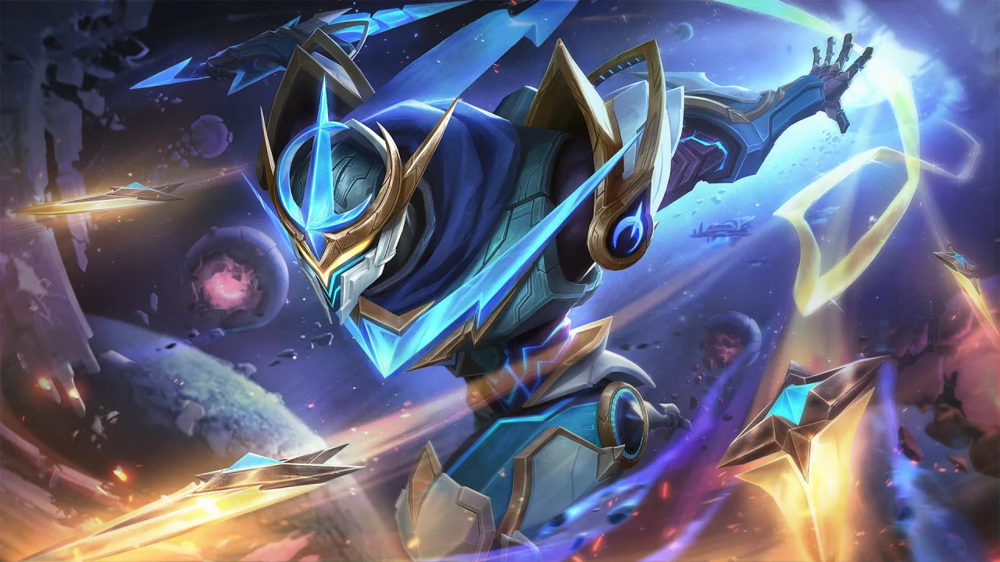

[Тир-лист](https://boostmlbb.ru/heroes/)[Предметы](https://boostmlbb.ru/items/)[Скины](https://boostmlbb.ru/skins/)[Новости и гайды](https://boostmlbb.ru/news/)

[Скины](https://boostmlbb.ru/skins/)/[Госсен](https://boostmlbb.ru/skins/gusion.html)/Космический отблеск

[Скин Госсена](https://boostmlbb.ru/skins/gusion.html)

# Космический отблеск

Cosmic Gleam

Высший SupremeЛегендарныйВ продаже

Как получить

Обменивается на 200 магических кристаллов из Магического колеса.

Цена

200 магических кристаллов

Вышел

6 января 2022

## Что меняет облик

-   Новая внешность
-   Новые эффекты навыков
-   Анимации навыков
-   Звуки навыков
-   Своя озвучка
-   Иконки навыков
-   Анимация показа
-   Сцена показа
-   Эффект возвращения
-   Рамка аватара
-   Достижение
-   Бонус к характеристикам

## Все скины Госсена [12](https://boostmlbb.ru/skins/gusion.html)

[Пустынный паукИсключительный · 2024](https://boostmlbb.ru/skins/gusion/desert-spider.html)[К'Грандиозный · 2024](https://boostmlbb.ru/skins/gusion/k.html)[Странник измеренийГрандиозный · 2023](https://boostmlbb.ru/skins/gusion/dimension-walker.html)[Откровение душиДелюкс · 2023](https://boostmlbb.ru/skins/gusion/soul-revelation.html)[Косми­ческий отблескВысший · 2022](https://boostmlbb.ru/skins/gusion/cosmic-gleam.html)[Ночная соваИзысканный · 2021](https://boostmlbb.ru/skins/gusion/night-owl.html)[Импера­торский скорпион V.E.N.O.M.Делюкс · 2019](https://boostmlbb.ru/skins/gusion/v-e-n-o-m-emperor-scorpion.html)[Опасная связьИсключительный · 2019](https://boostmlbb.ru/skins/gusion/dangerous-liaison.html)[КиберотрядИсключительный · 2018](https://boostmlbb.ru/skins/gusion/cyber-ops.html)[СтилистОбычный · 2018](https://boostmlbb.ru/skins/gusion/hairstylist.html)[Лунная сонатаОбычный · 2018](https://boostmlbb.ru/skins/gusion/moonlight-sonata.html)[Минато Намикадзе](https://boostmlbb.ru/skins/gusion/minato-namikaze.html)

## Серия «Легендарный»

[Призрак розАльфа · 2025](https://boostmlbb.ru/skins/alpha/revenant-of-roses.html)[Повелитель мировДжонсон · 2025](https://boostmlbb.ru/skins/johnson/sovereign-of-realms.html)[Галакти­ческая победи­тельницаФрейя · 2024](https://boostmlbb.ru/skins/freya/galactic-vanquisher.html)[Божествен­ная богиняЛюнокс · 2023](https://boostmlbb.ru/skins/lunox/divine-goddess.html)[Король адаФранко · 2023](https://boostmlbb.ru/skins/franco/king-of-hell.html)[Псион будущегоГвиневра · 2022](https://boostmlbb.ru/skins/guinevere/psion-of-tomorrow.html)[Адское пламяВалир · 2022](https://boostmlbb.ru/skins/valir/infernal-blaze.html)[Рыцарь звездопадаГрейнджер · 2021](https://boostmlbb.ru/skins/granger/starfall-knight.html)

**Поднимем ранг на герое Госсен**Цена считается в калькуляторе

[Рассчитать цену](https://boostmlbb.ru/order.html?type=hero)

## Частые вопросы

Как получить скин «Космический отблеск» на Госсена?

Обменивается на 200 магических кристаллов из Магического колеса.

Когда вышел скин «Космический отблеск»?

6 января 2022.

Какой класс у скина «Космический отблеск»?

Высший (Supreme), серия «Легендарный».
