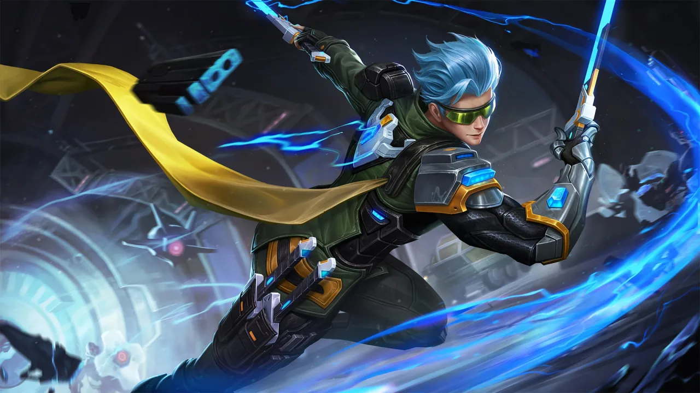

[Скины Госсена](https://boostmlbb.ru/skins/gusion.html)

[Скины](https://boostmlbb.ru/skins/)/[Госсен](https://boostmlbb.ru/skins/gusion.html)/Киберотряд

[Скин Госсена](https://boostmlbb.ru/skins/gusion.html)

# Киберотряд

Cyber Ops

Исключительный ExceptionalЗвёздный участникОграниченный

Как получить

Награда «Звёздного участника» в октябре 2018.

Вышел

1 октября 2018

## Что меняет облик

-   Новая внешность
-   Новые эффекты навыков
-   Анимация показа
-   Бонус к характеристикам

## Все скины Госсена [12](https://boostmlbb.ru/skins/gusion.html)

[Пустынный паукИсключительный · 2024](https://boostmlbb.ru/skins/gusion/desert-spider.html)[К'Грандиозный · 2024](https://boostmlbb.ru/skins/gusion/k.html)[Странник измеренийГрандиозный · 2023](https://boostmlbb.ru/skins/gusion/dimension-walker.html)[Откровение душиДелюкс · 2023](https://boostmlbb.ru/skins/gusion/soul-revelation.html)[Косми­ческий отблескВысший · 2022](https://boostmlbb.ru/skins/gusion/cosmic-gleam.html)[Ночная соваИзысканный · 2021](https://boostmlbb.ru/skins/gusion/night-owl.html)[Импера­торский скорпион V.E.N.O.M.Делюкс · 2019](https://boostmlbb.ru/skins/gusion/v-e-n-o-m-emperor-scorpion.html)[Опасная связьИсключительный · 2019](https://boostmlbb.ru/skins/gusion/dangerous-liaison.html)[КиберотрядИсключительный · 2018](https://boostmlbb.ru/skins/gusion/cyber-ops.html)[СтилистОбычный · 2018](https://boostmlbb.ru/skins/gusion/hairstylist.html)[Лунная сонатаОбычный · 2018](https://boostmlbb.ru/skins/gusion/moonlight-sonata.html)[Минато Намикадзе](https://boostmlbb.ru/skins/gusion/minato-namikaze.html)

## Серия «Звёздный участник»

[Морячка, рождённая приливомКалеа · 2026](https://boostmlbb.ru/skins/kalea/tideborn-sailor.html)[Тень кицунэХаябуса · 2026](https://boostmlbb.ru/skins/hayabusa/kitsune-s-shadow.html)[Клыки резниХанзо · 2026](https://boostmlbb.ru/skins/hanzo/fangs-of-slaughter.html)[Тлеющая крепостьБелерик · 2026](https://boostmlbb.ru/skins/belerick/smouldering-fortress.html)[Магитех­нический призракОбсидия · 2026](https://boostmlbb.ru/skins/obsidia/magitech-wraith.html)[Элизийское сияниеЦзэтянь · 2026](https://boostmlbb.ru/skins/zetian/elysian-luminance.html)[Батальон стражейХильда · 2026](https://boostmlbb.ru/skins/hilda/guardian-battalion.html)[Мечта­тельный коиХарли · 2026](https://boostmlbb.ru/skins/harley/dreaming-koi.html)

**Сколько стоит буст на герое Госсен?**Выберите текущий и желаемый ранг. Стоимость появится на сайте.

[Рассчитать цену](https://boostmlbb.ru/order.html?type=hero)

## Частые вопросы

Как получить скин «Киберотряд» на Госсена?

Награда «Звёздного участника» в октябре 2018.

Когда вышел скин «Киберотряд»?

1 октября 2018.

Какой класс у скина «Киберотряд»?

Исключительный (Exceptional), серия «Звёздный участник».
